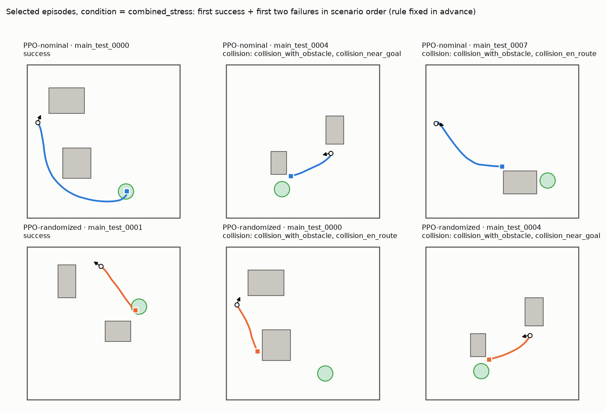
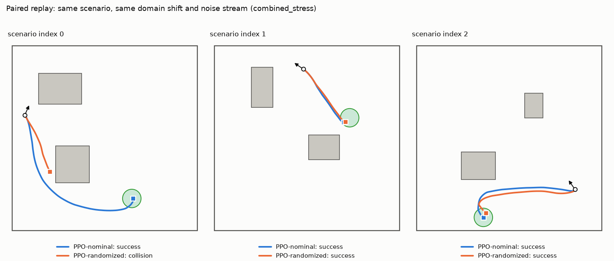
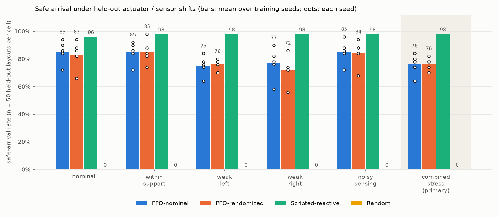
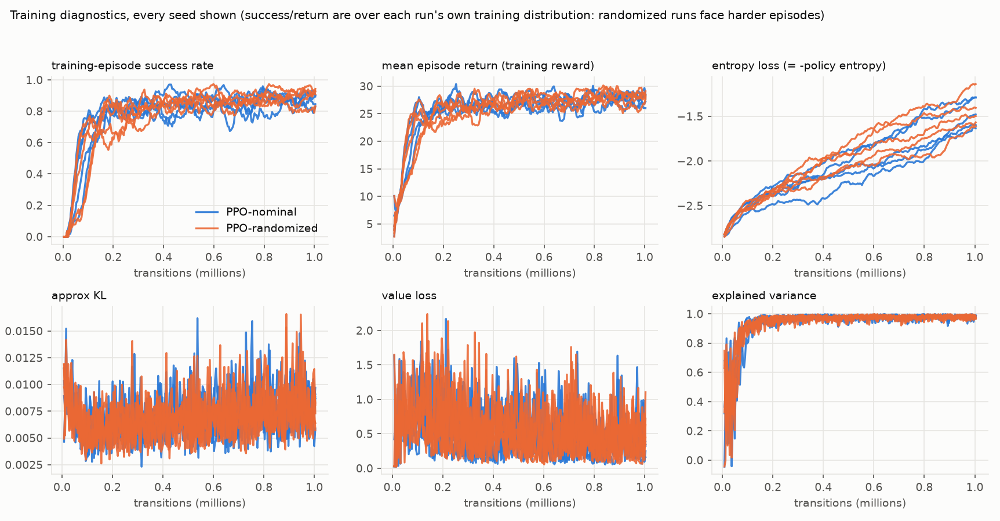

<!-- Generated by `roborobust report` from results/weekend/episode_results.jsonl and copied here by scripts/publish_report.py. Do not edit by hand; regenerate. Full set of tables/plots: reports/weekend/ -->

# RoboRobust results -- suite `test`

> 5 training seeds per condition (intervals over seeds are exploratory).
> **Simulation only.** No physical robot, no sim-to-real claim. Goal position and velocities are privileged simulator inputs; the policy is a feedforward MLP. All numbers below are computed from `episode_results.jsonl`.

## Hypothesis and design

Hypothesis: a PPO policy trained with modest variation in wheel-motor strength and range-sensor noise (*PPO-randomized*) has a higher safe-arrival rate under held-out actuator and sensor shifts than a PPO policy trained under nominal conditions (*PPO-nominal*), possibly at a nominal-performance cost. Both conditions share the same PPO settings, reward, scenario distribution, seeds and transition budget. Because the intervention is *combined* (motor + noise), any effect is attributed to the combined intervention, not to either component.

* Evaluation: 50 held-out layouts x 6 conditions x each policy, deterministic inference, paired scenarios and noise streams (eval_seed=20260601). Primary endpoint (specified before the final evaluation): safe-arrival rate under **combined_stress** on unseen layouts.
* Safe arrival = verifier success (within 0.30 m, <= 0.10 m/s for 5 consecutive control steps, no wall/obstacle contact). Timeouts at 600 control steps (30 s) are an external cutoff.

Evaluation episodes: 3600 (72 policy x seed x condition cells). Complete: **True**.

## Primary endpoint and secondary conditions

Safe-arrival rate, mean over training seeds (50 episodes per seed per cell; `combined_stress` is primary):

| policy | nominal | within_support | weak_left | weak_right | noisy_sensing | combined_stress |
|---|---|---|---|---|---|---|
| PPO-nominal | 85.2% | 84.8% | 75.2% | 76.8% | 85.2% | 76.0% |
| PPO-randomized | 83.2% | 85.2% | 76.4% | 72.0% | 84.4% | 76.4% |
| Scripted-reactive | 96.0% | 98.0% | 98.0% | 98.0% | 98.0% | 98.0% |
| Random | 0.0% | 0.0% | 0.0% | 0.0% | 0.0% | 0.0% |

Per-seed values and spread (std across training seeds, in percentage points):

| policy | condition | n_seeds | per_seed | std_over_seeds_pp | pooled_successes | pooled_episodes |
|---|---|---|---|---|---|---|
| nominal | nominal | 5 | 90%, 72%, 84%, 86%, 94% | 8.3 | 213 | 250 |
| nominal | within_support | 5 | 90%, 72%, 86%, 84%, 92% | 7.8 | 212 | 250 |
| nominal | weak_left | 5 | 84%, 78%, 74%, 64%, 76% | 7.3 | 188 | 250 |
| nominal | weak_right | 5 | 90%, 58%, 76%, 82%, 78% | 11.8 | 192 | 250 |
| nominal | noisy_sensing | 5 | 88%, 72%, 84%, 86%, 96% | 8.7 | 213 | 250 |
| nominal | combined_stress | 5 | 84%, 80%, 74%, 64%, 78% | 7.6 | 190 | 250 |
| randomized | nominal | 5 | 82%, 66%, 94%, 86%, 88% | 10.5 | 208 | 250 |
| randomized | within_support | 5 | 84%, 74%, 98%, 82%, 88% | 8.8 | 213 | 250 |
| randomized | weak_left | 5 | 78%, 78%, 80%, 70%, 76% | 3.8 | 191 | 250 |
| randomized | weak_right | 5 | 74%, 56%, 86%, 72%, 72% | 10.7 | 180 | 250 |
| randomized | noisy_sensing | 5 | 84%, 68%, 94%, 88%, 88% | 9.8 | 211 | 250 |
| randomized | combined_stress | 5 | 78%, 74%, 82%, 70%, 78% | 4.6 | 191 | 250 |
| scripted | nominal | 1 | 96% | n/a (1 seed) | 48 | 50 |
| scripted | within_support | 1 | 98% | n/a (1 seed) | 49 | 50 |
| scripted | weak_left | 1 | 98% | n/a (1 seed) | 49 | 50 |
| scripted | weak_right | 1 | 98% | n/a (1 seed) | 49 | 50 |
| scripted | noisy_sensing | 1 | 98% | n/a (1 seed) | 49 | 50 |
| scripted | combined_stress | 1 | 98% | n/a (1 seed) | 49 | 50 |
| random | nominal | 1 | 0% | n/a (1 seed) | 0 | 50 |
| random | within_support | 1 | 0% | n/a (1 seed) | 0 | 50 |
| random | weak_left | 1 | 0% | n/a (1 seed) | 0 | 50 |
| random | weak_right | 1 | 0% | n/a (1 seed) | 0 | 50 |
| random | noisy_sensing | 1 | 0% | n/a (1 seed) | 0 | 50 |
| random | combined_stress | 1 | 0% | n/a (1 seed) | 0 | 50 |

Per-seed Wilson 95% intervals describe uncertainty over the sampled *scenarios* only; they do not capture training-seed variability:

| policy | seed | condition | successes | n_episodes | success_rate | wilson_95 |
|---|---|---|---|---|---|---|
| nominal | 0 | nominal | 45 | 50 | 90.0% | [79%, 96%] |
| nominal | 0 | within_support | 45 | 50 | 90.0% | [79%, 96%] |
| nominal | 0 | weak_left | 42 | 50 | 84.0% | [71%, 92%] |
| nominal | 0 | weak_right | 45 | 50 | 90.0% | [79%, 96%] |
| nominal | 0 | noisy_sensing | 44 | 50 | 88.0% | [76%, 94%] |
| nominal | 0 | combined_stress | 42 | 50 | 84.0% | [71%, 92%] |
| nominal | 1 | nominal | 36 | 50 | 72.0% | [58%, 83%] |
| nominal | 1 | within_support | 36 | 50 | 72.0% | [58%, 83%] |
| nominal | 1 | weak_left | 39 | 50 | 78.0% | [65%, 87%] |
| nominal | 1 | weak_right | 29 | 50 | 58.0% | [44%, 71%] |
| nominal | 1 | noisy_sensing | 36 | 50 | 72.0% | [58%, 83%] |
| nominal | 1 | combined_stress | 40 | 50 | 80.0% | [67%, 89%] |
| nominal | 2 | nominal | 42 | 50 | 84.0% | [71%, 92%] |
| nominal | 2 | within_support | 43 | 50 | 86.0% | [74%, 93%] |
| nominal | 2 | weak_left | 37 | 50 | 74.0% | [60%, 84%] |
| nominal | 2 | weak_right | 38 | 50 | 76.0% | [63%, 86%] |
| nominal | 2 | noisy_sensing | 42 | 50 | 84.0% | [71%, 92%] |
| nominal | 2 | combined_stress | 37 | 50 | 74.0% | [60%, 84%] |
| nominal | 3 | nominal | 43 | 50 | 86.0% | [74%, 93%] |
| nominal | 3 | within_support | 42 | 50 | 84.0% | [71%, 92%] |
| nominal | 3 | weak_left | 32 | 50 | 64.0% | [50%, 76%] |
| nominal | 3 | weak_right | 41 | 50 | 82.0% | [69%, 90%] |
| nominal | 3 | noisy_sensing | 43 | 50 | 86.0% | [74%, 93%] |
| nominal | 3 | combined_stress | 32 | 50 | 64.0% | [50%, 76%] |
| nominal | 4 | nominal | 47 | 50 | 94.0% | [84%, 98%] |
| nominal | 4 | within_support | 46 | 50 | 92.0% | [81%, 97%] |
| nominal | 4 | weak_left | 38 | 50 | 76.0% | [63%, 86%] |
| nominal | 4 | weak_right | 39 | 50 | 78.0% | [65%, 87%] |
| nominal | 4 | noisy_sensing | 48 | 50 | 96.0% | [87%, 99%] |
| nominal | 4 | combined_stress | 39 | 50 | 78.0% | [65%, 87%] |
| randomized | 0 | nominal | 41 | 50 | 82.0% | [69%, 90%] |
| randomized | 0 | within_support | 42 | 50 | 84.0% | [71%, 92%] |
| randomized | 0 | weak_left | 39 | 50 | 78.0% | [65%, 87%] |
| randomized | 0 | weak_right | 37 | 50 | 74.0% | [60%, 84%] |
| randomized | 0 | noisy_sensing | 42 | 50 | 84.0% | [71%, 92%] |
| randomized | 0 | combined_stress | 39 | 50 | 78.0% | [65%, 87%] |
| randomized | 1 | nominal | 33 | 50 | 66.0% | [52%, 78%] |
| randomized | 1 | within_support | 37 | 50 | 74.0% | [60%, 84%] |
| randomized | 1 | weak_left | 39 | 50 | 78.0% | [65%, 87%] |
| randomized | 1 | weak_right | 28 | 50 | 56.0% | [42%, 69%] |
| randomized | 1 | noisy_sensing | 34 | 50 | 68.0% | [54%, 79%] |
| randomized | 1 | combined_stress | 37 | 50 | 74.0% | [60%, 84%] |
| randomized | 2 | nominal | 47 | 50 | 94.0% | [84%, 98%] |
| randomized | 2 | within_support | 49 | 50 | 98.0% | [90%, 100%] |
| randomized | 2 | weak_left | 40 | 50 | 80.0% | [67%, 89%] |
| randomized | 2 | weak_right | 43 | 50 | 86.0% | [74%, 93%] |
| randomized | 2 | noisy_sensing | 47 | 50 | 94.0% | [84%, 98%] |
| randomized | 2 | combined_stress | 41 | 50 | 82.0% | [69%, 90%] |
| randomized | 3 | nominal | 43 | 50 | 86.0% | [74%, 93%] |
| randomized | 3 | within_support | 41 | 50 | 82.0% | [69%, 90%] |
| randomized | 3 | weak_left | 35 | 50 | 70.0% | [56%, 81%] |
| randomized | 3 | weak_right | 36 | 50 | 72.0% | [58%, 83%] |
| randomized | 3 | noisy_sensing | 44 | 50 | 88.0% | [76%, 94%] |
| randomized | 3 | combined_stress | 35 | 50 | 70.0% | [56%, 81%] |
| randomized | 4 | nominal | 44 | 50 | 88.0% | [76%, 94%] |
| randomized | 4 | within_support | 44 | 50 | 88.0% | [76%, 94%] |
| randomized | 4 | weak_left | 38 | 50 | 76.0% | [63%, 86%] |
| randomized | 4 | weak_right | 36 | 50 | 72.0% | [58%, 83%] |
| randomized | 4 | noisy_sensing | 44 | 50 | 88.0% | [76%, 94%] |
| randomized | 4 | combined_stress | 39 | 50 | 78.0% | [65%, 87%] |
| scripted | - | nominal | 48 | 50 | 96.0% | [87%, 99%] |
| scripted | - | within_support | 49 | 50 | 98.0% | [90%, 100%] |
| scripted | - | weak_left | 49 | 50 | 98.0% | [90%, 100%] |
| scripted | - | weak_right | 49 | 50 | 98.0% | [90%, 100%] |
| scripted | - | noisy_sensing | 49 | 50 | 98.0% | [90%, 100%] |
| scripted | - | combined_stress | 49 | 50 | 98.0% | [90%, 100%] |
| random | - | nominal | 0 | 50 | 0.0% | [0%, 7%] |
| random | - | within_support | 0 | 50 | 0.0% | [0%, 7%] |
| random | - | weak_left | 0 | 50 | 0.0% | [0%, 7%] |
| random | - | weak_right | 0 | 50 | 0.0% | [0%, 7%] |
| random | - | noisy_sensing | 0 | 50 | 0.0% | [0%, 7%] |
| random | - | combined_stress | 0 | 50 | 0.0% | [0%, 7%] |

## Paired comparison: PPO-randomized minus PPO-nominal

Bootstrap over scenario IDs (10,000 resamples; the same resampled IDs are used for both policies, so the pairing is retained). `scenario` interval averages over training seeds and resamples scenarios only. `hierarchical` additionally resamples training seeds independently within each policy; with few seeds it is **exploratory** and limited in precision.

| condition | diff (pp) | scenario 95% (pp) | hierarchical 95% (pp) |
|---|---|---|---|
| nominal | -2.0 | [-6.4, 2.4] | [-14.8, 10.8] |
| within_support | 0.4 | [-5.2, 6.0] | [-11.2, 12.8] |
| weak_left | 1.2 | [-4.8, 7.2] | [-9.2, 11.6] |
| weak_right | -4.8 | [-10.8, 1.2] | [-19.6, 10.8] |
| noisy_sensing | -0.8 | [-4.8, 3.2] | [-13.2, 11.6] |
| combined_stress | 0.4 | [-5.2, 6.0] | [-10.0, 11.2] |

**Primary endpoint reading (combined_stress):** difference +0.4 pp (randomized minus nominal). Scenario-only 95% interval [-5.2, 6.0] pp; hierarchical (seeds and scenarios) 95% interval [-10.0, 11.2] pp, which includes zero. This is a statement about these seeds and these held-out layouts under simulated shifts; it is not evidence about hardware.

The data show no advantage for randomization on the primary endpoint; an interval that includes zero means no difference could be detected, not that none exists. Candidate explanations listed here were **not tested** (§Limits gives a discriminating follow-up): stress levels that the nominal policy already largely tolerates; a hidden-parameter / noisy-observation problem that is partially observed for a feedforward policy; a transition budget at which neither policy has converged to its robust form; seed-to-seed variance larger than the effect.

### Exploratory (not pre-specified): robustness gap

Each policy's drop from its own nominal-condition score to a shifted condition, and the difference of the two drops (`did` > 0: the randomized policy loses *less* than the nominal policy; < 0: more). Same bootstrap as above (scenario IDs shared across all four cells). Added after seeing validation behaviour to match the hypothesis's wording about robustness under shifts and a possible nominal-performance trade-off; treat intervals that include zero as no evidence either way.

| condition | randomized drop (pp) | nominal drop (pp) | did (pp) | scenario 95% (pp) | hierarchical 95% (pp) |
|---|---|---|---|---|---|
| within_support | -2.0 | 0.4 | 2.4 | [-1.6, 6.4] | [-4.0, 9.6] |
| weak_left | 6.8 | 10.0 | 3.2 | [-4.0, 10.4] | [-12.4, 19.6] |
| weak_right | 11.2 | 8.4 | -2.8 | [-8.4, 2.8] | [-13.2, 7.2] |
| noisy_sensing | -1.2 | 0.0 | 1.2 | [-1.6, 4.0] | [-2.8, 5.6] |
| combined_stress | 6.8 | 9.2 | 2.4 | [-4.4, 8.8] | [-13.2, 17.6] |

## Pre-declared secondary: budget sensitivity (checkpoints at ~500k transitions)

The same ten runs, evaluated with the identical frozen suite at their periodic checkpoint `step_000503808` (123 rollouts = 503,808 transitions), declared as a secondary analysis in `DECISIONS.md` before any test evaluation. Full tables: `reports/weekend_500k/REPORT.md`.

| policy | nominal | within_support | weak_left | weak_right | noisy_sensing | combined_stress |
|---|---|---|---|---|---|---|
| PPO-nominal | 82.0% | 82.8% | 82.0% | 75.6% | 82.4% | 81.2% |
| PPO-randomized | 82.4% | 82.4% | 76.0% | 71.2% | 82.8% | 75.2% |

Randomized minus nominal at ~500k (same bootstrap as above):

| condition | diff (pp) | scenario 95% (pp) | hierarchical 95% (pp) |
|---|---|---|---|
| nominal | 0.4 | [-5.6, 6.0] | [-10.4, 11.2] |
| within_support | -0.4 | [-4.8, 4.0] | [-10.8, 10.0] |
| weak_left | -6.0 | [-12.0, 0.0] | [-18.4, 5.6] |
| weak_right | -4.4 | [-10.8, 2.0] | [-16.4, 7.2] |
| noisy_sensing | 0.4 | [-4.4, 5.2] | [-9.6, 10.8] |
| combined_stress | -6.0 | [-12.4, 0.4] | [-18.0, 5.6] |

Reading this alongside the final-checkpoint result shows how sensitive the comparison is to the training budget; it is not a second independent test (same runs, same layouts).

## Baselines

| policy | nominal | within_support | weak_left | weak_right | noisy_sensing | combined_stress |
|---|---|---|---|---|---|---|
| Scripted-reactive | 96.0% | 98.0% | 98.0% | 98.0% | 98.0% | 98.0% |
| Random | 0.0% | 0.0% | 0.0% | 0.0% | 0.0% | 0.0% |

The scripted reactive controller uses the same 29-element observation as PPO and no map. Its score is a measure of task difficulty for a hand-coded controller and bounds how much headroom RL has on this task; random is a sanity floor.

## Outcome breakdown, durations and path lengths

Outcomes sum to the episode count in every cell (checked). Durations cover all outcomes; time-to-goal and success path length use successes only (n shown); failure path length is separate. Return columns are **training reward, not task performance**.

| policy | seed | condition | n_episodes | successes | collisions | timeouts | other_failures | duration_mean_s_all | time_to_goal_mean_s_successes | n_time_to_goal | path_length_mean_m_successes | path_length_mean_m_failures | TRAINING_REWARD_return_mean |
|---|---|---|---|---|---|---|---|---|---|---|---|---|---|
| nominal | 0 | nominal | 50 | 45 | 5 | 0 | 0 | 10.33 | 10.84 | 45 | 3.98 | 1.88 | 29.39 |
| nominal | 0 | within_support | 50 | 45 | 5 | 0 | 0 | 10.56 | 11.07 | 45 | 4.06 | 2.11 | 29.40 |
| nominal | 0 | weak_left | 50 | 42 | 7 | 1 | 0 | 13.12 | 13.90 | 42 | 4.16 | 1.85 | 28.21 |
| nominal | 0 | weak_right | 50 | 45 | 3 | 2 | 0 | 13.05 | 12.69 | 45 | 3.92 | 3.73 | 29.70 |
| nominal | 0 | noisy_sensing | 50 | 44 | 6 | 0 | 0 | 10.13 | 10.60 | 44 | 3.94 | 2.27 | 29.03 |
| nominal | 0 | combined_stress | 50 | 42 | 8 | 0 | 0 | 12.78 | 13.94 | 42 | 4.16 | 2.05 | 28.40 |
| nominal | 1 | nominal | 50 | 36 | 14 | 0 | 0 | 9.30 | 10.32 | 36 | 3.83 | 2.39 | 25.96 |
| nominal | 1 | within_support | 50 | 36 | 14 | 0 | 0 | 8.98 | 9.95 | 36 | 3.74 | 2.36 | 25.96 |
| nominal | 1 | weak_left | 50 | 39 | 9 | 2 | 0 | 11.82 | 11.98 | 39 | 3.90 | 2.86 | 27.34 |
| nominal | 1 | weak_right | 50 | 29 | 20 | 1 | 0 | 11.90 | 13.70 | 29 | 4.03 | 2.49 | 23.33 |
| nominal | 1 | noisy_sensing | 50 | 36 | 14 | 0 | 0 | 9.37 | 10.37 | 36 | 3.84 | 2.41 | 25.98 |
| nominal | 1 | combined_stress | 50 | 40 | 9 | 1 | 0 | 11.29 | 12.06 | 40 | 3.93 | 2.13 | 27.67 |
| nominal | 2 | nominal | 50 | 42 | 1 | 7 | 0 | 13.95 | 11.43 | 42 | 4.05 | 2.39 | 27.89 |
| nominal | 2 | within_support | 50 | 43 | 0 | 7 | 0 | 13.86 | 11.23 | 43 | 4.09 | 2.52 | 28.34 |
| nominal | 2 | weak_left | 50 | 37 | 8 | 5 | 0 | 13.71 | 13.37 | 37 | 4.18 | 1.69 | 26.08 |
| nominal | 2 | weak_right | 50 | 38 | 7 | 5 | 0 | 13.70 | 12.85 | 38 | 3.82 | 2.08 | 26.45 |
| nominal | 2 | noisy_sensing | 50 | 42 | 2 | 6 | 0 | 13.77 | 11.36 | 42 | 4.06 | 2.48 | 28.00 |
| nominal | 2 | combined_stress | 50 | 37 | 8 | 5 | 0 | 13.62 | 13.33 | 37 | 4.18 | 1.76 | 26.10 |
| nominal | 3 | nominal | 50 | 43 | 2 | 5 | 0 | 12.95 | 11.28 | 43 | 4.17 | 4.47 | 28.90 |
| nominal | 3 | within_support | 50 | 42 | 4 | 4 | 0 | 12.79 | 11.97 | 42 | 4.37 | 3.44 | 28.41 |
| nominal | 3 | weak_left | 50 | 32 | 16 | 2 | 0 | 13.40 | 14.49 | 32 | 4.48 | 2.78 | 24.70 |
| nominal | 3 | weak_right | 50 | 41 | 3 | 6 | 0 | 14.38 | 12.90 | 41 | 4.01 | 3.62 | 28.47 |
| nominal | 3 | noisy_sensing | 50 | 43 | 2 | 5 | 0 | 13.06 | 11.54 | 43 | 4.26 | 4.20 | 28.89 |
| nominal | 3 | combined_stress | 50 | 32 | 16 | 2 | 0 | 13.31 | 14.55 | 32 | 4.49 | 2.83 | 24.64 |
| nominal | 4 | nominal | 50 | 47 | 2 | 1 | 0 | 11.88 | 11.81 | 47 | 4.09 | 2.61 | 30.33 |
| nominal | 4 | within_support | 50 | 46 | 2 | 2 | 0 | 12.27 | 11.86 | 46 | 4.09 | 3.59 | 30.01 |
| nominal | 4 | weak_left | 50 | 38 | 8 | 4 | 0 | 15.70 | 15.68 | 38 | 4.58 | 3.48 | 27.36 |
| nominal | 4 | weak_right | 50 | 39 | 10 | 1 | 0 | 11.90 | 12.94 | 39 | 3.86 | 2.20 | 27.29 |
| nominal | 4 | noisy_sensing | 50 | 48 | 2 | 0 | 0 | 11.49 | 11.78 | 48 | 4.07 | 1.76 | 30.62 |
| nominal | 4 | combined_stress | 50 | 39 | 8 | 3 | 0 | 15.56 | 15.92 | 39 | 4.65 | 2.95 | 27.61 |
| randomized | 0 | nominal | 50 | 41 | 4 | 5 | 0 | 11.50 | 10.12 | 41 | 3.74 | 3.95 | 28.12 |
| randomized | 0 | within_support | 50 | 42 | 3 | 5 | 0 | 12.00 | 10.48 | 42 | 3.88 | 3.14 | 28.37 |
| randomized | 0 | weak_left | 50 | 39 | 8 | 3 | 0 | 12.59 | 12.46 | 39 | 3.83 | 2.55 | 27.15 |
| randomized | 0 | weak_right | 50 | 37 | 8 | 5 | 0 | 12.00 | 11.27 | 37 | 3.50 | 3.59 | 26.98 |
| randomized | 0 | noisy_sensing | 50 | 42 | 5 | 3 | 0 | 11.20 | 10.72 | 42 | 3.85 | 3.39 | 28.33 |
| randomized | 0 | combined_stress | 50 | 39 | 9 | 2 | 0 | 12.51 | 12.83 | 39 | 3.87 | 2.64 | 27.15 |
| randomized | 1 | nominal | 50 | 33 | 13 | 4 | 0 | 11.62 | 11.01 | 33 | 4.06 | 3.29 | 24.74 |
| randomized | 1 | within_support | 50 | 37 | 8 | 5 | 0 | 12.29 | 11.33 | 37 | 4.21 | 3.12 | 26.41 |
| randomized | 1 | weak_left | 50 | 39 | 5 | 6 | 0 | 13.93 | 12.74 | 39 | 3.97 | 2.70 | 27.42 |
| randomized | 1 | weak_right | 50 | 28 | 20 | 2 | 0 | 13.36 | 15.14 | 28 | 4.53 | 3.01 | 23.13 |
| randomized | 1 | noisy_sensing | 50 | 34 | 12 | 4 | 0 | 11.84 | 11.23 | 34 | 4.15 | 3.29 | 25.13 |
| randomized | 1 | combined_stress | 50 | 37 | 6 | 7 | 0 | 13.91 | 12.43 | 37 | 3.80 | 3.39 | 26.83 |
| randomized | 2 | nominal | 50 | 47 | 3 | 0 | 0 | 10.27 | 10.63 | 47 | 4.02 | 1.60 | 30.21 |
| randomized | 2 | within_support | 50 | 49 | 1 | 0 | 0 | 10.95 | 11.12 | 49 | 4.16 | 0.98 | 31.02 |
| randomized | 2 | weak_left | 50 | 40 | 10 | 0 | 0 | 12.16 | 14.09 | 40 | 4.41 | 1.35 | 27.65 |
| randomized | 2 | weak_right | 50 | 43 | 7 | 0 | 0 | 11.53 | 12.44 | 43 | 3.92 | 1.99 | 28.72 |
| randomized | 2 | noisy_sensing | 50 | 47 | 3 | 0 | 0 | 10.64 | 11.02 | 47 | 4.07 | 1.61 | 30.14 |
| randomized | 2 | combined_stress | 50 | 41 | 9 | 0 | 0 | 12.37 | 14.13 | 41 | 4.39 | 1.35 | 28.01 |
| randomized | 3 | nominal | 50 | 43 | 3 | 4 | 0 | 12.18 | 10.93 | 43 | 4.20 | 2.79 | 28.77 |
| randomized | 3 | within_support | 50 | 41 | 5 | 4 | 0 | 12.30 | 11.43 | 41 | 4.29 | 2.57 | 27.99 |
| randomized | 3 | weak_left | 50 | 35 | 12 | 3 | 0 | 12.97 | 14.31 | 35 | 4.46 | 1.98 | 25.76 |
| randomized | 3 | weak_right | 50 | 36 | 9 | 5 | 0 | 13.46 | 13.01 | 36 | 4.10 | 2.53 | 26.26 |
| randomized | 3 | noisy_sensing | 50 | 44 | 3 | 3 | 0 | 11.56 | 10.85 | 44 | 4.17 | 2.05 | 29.08 |
| randomized | 3 | combined_stress | 50 | 35 | 12 | 3 | 0 | 12.95 | 14.29 | 35 | 4.46 | 1.98 | 25.76 |
| randomized | 4 | nominal | 50 | 44 | 3 | 3 | 0 | 11.24 | 10.15 | 44 | 3.81 | 1.93 | 28.88 |
| randomized | 4 | within_support | 50 | 44 | 1 | 5 | 0 | 12.20 | 10.44 | 44 | 3.89 | 2.42 | 28.89 |
| randomized | 4 | weak_left | 50 | 38 | 7 | 5 | 0 | 13.97 | 13.37 | 38 | 4.13 | 2.42 | 26.65 |
| randomized | 4 | weak_right | 50 | 36 | 8 | 6 | 0 | 13.48 | 12.77 | 36 | 3.94 | 1.78 | 25.58 |
| randomized | 4 | noisy_sensing | 50 | 44 | 3 | 3 | 0 | 11.34 | 10.63 | 44 | 3.88 | 2.08 | 28.76 |
| randomized | 4 | combined_stress | 50 | 39 | 7 | 4 | 0 | 13.62 | 13.34 | 39 | 4.10 | 2.37 | 26.94 |
| scripted | - | nominal | 50 | 48 | 0 | 2 | 0 | 14.50 | 13.86 | 48 | 3.43 | 2.99 | 30.90 |
| scripted | - | within_support | 50 | 49 | 0 | 1 | 0 | 14.59 | 14.27 | 49 | 3.49 | 2.30 | 31.31 |
| scripted | - | weak_left | 50 | 49 | 0 | 1 | 0 | 15.15 | 14.85 | 49 | 3.49 | 2.64 | 31.40 |
| scripted | - | weak_right | 50 | 49 | 0 | 1 | 0 | 15.18 | 14.87 | 49 | 3.51 | 1.58 | 31.41 |
| scripted | - | noisy_sensing | 50 | 49 | 0 | 1 | 0 | 14.42 | 14.11 | 49 | 3.51 | 1.94 | 31.30 |
| scripted | - | combined_stress | 50 | 49 | 0 | 1 | 0 | 14.83 | 14.52 | 49 | 3.49 | 2.64 | 31.38 |
| random | - | nominal | 50 | 0 | 3 | 47 | 0 | 29.26 |  | 0 |  | 2.00 | 7.20 |
| random | - | within_support | 50 | 0 | 4 | 46 | 0 | 28.50 |  | 0 |  | 1.90 | 7.21 |
| random | - | weak_left | 50 | 0 | 2 | 48 | 0 | 29.10 |  | 0 |  | 1.70 | 7.02 |
| random | - | weak_right | 50 | 0 | 2 | 48 | 0 | 29.24 |  | 0 |  | 1.71 | 7.07 |
| random | - | noisy_sensing | 50 | 0 | 3 | 47 | 0 | 28.83 |  | 0 |  | 1.99 | 7.12 |
| random | - | combined_stress | 50 | 0 | 2 | 48 | 0 | 29.53 |  | 0 |  | 1.74 | 7.18 |

## Failure taxonomy (automatic tags, multi-label)

Heuristic tags from logged episode features; thresholds: `turning_yaw_rate`=0.8, `passage_clearance`=0.9, `stop_speed`=0.02, `short_band`=0.75, `circling_yaw_travel`=12.6, `drift_yaw_rate`=0.1, `drift_min_steps`=20, `asymmetry`=0.2, `near_goal`=1. `stalled_before_obstructed_route` is an extra tag (stopped far from the goal when the straight line was blocked). Tags are defensible heuristics, not ground-truth causes; manual labels can be merged with `--manual-labels`.

| policy | condition | episodes | failures | circling_oscillation | collision_en_route | collision_near_goal | collision_near_passage | collision_while_turning | collision_with_obstacle | collision_with_wall | stalled_before_obstructed_route | stopping_short | timeout_despite_clear_route | unclassified | motor_asymmetry_drift |
|---|---|---|---|---|---|---|---|---|---|---|---|---|---|---|---|
| nominal | nominal | 250 | 37 | 1 | 23 | 1 | 7 | 3 | 18 | 6 | 3 | 5 | 1 | 3 | 0 |
| nominal | within_support | 250 | 38 | 2 | 22 | 3 | 7 | 2 | 19 | 6 | 3 | 5 | 1 | 2 | 1 |
| nominal | weak_left | 250 | 62 | 3 | 38 | 10 | 9 | 3 | 42 | 6 | 5 | 0 | 2 | 4 | 25 |
| nominal | weak_right | 250 | 58 | 1 | 40 | 3 | 8 | 4 | 36 | 7 | 4 | 3 | 0 | 3 | 14 |
| nominal | noisy_sensing | 250 | 37 | 2 | 24 | 2 | 8 | 2 | 21 | 5 | 1 | 4 | 1 | 4 | 0 |
| nominal | combined_stress | 250 | 60 | 3 | 40 | 9 | 10 | 1 | 43 | 6 | 3 | 0 | 2 | 3 | 28 |
| random | nominal | 50 | 50 | 45 | 3 | 0 | 1 | 0 | 1 | 2 | 3 | 0 | 22 | 1 | 0 |
| random | within_support | 50 | 50 | 44 | 4 | 0 | 3 | 0 | 3 | 1 | 2 | 0 | 22 | 1 | 9 |
| random | weak_left | 50 | 50 | 4 | 2 | 0 | 2 | 0 | 0 | 2 | 5 | 0 | 22 | 13 | 14 |
| random | weak_right | 50 | 50 | 5 | 2 | 0 | 2 | 0 | 1 | 1 | 7 | 0 | 21 | 13 | 20 |
| random | noisy_sensing | 50 | 50 | 43 | 3 | 0 | 1 | 0 | 1 | 2 | 1 | 0 | 22 | 3 | 0 |
| random | combined_stress | 50 | 50 | 5 | 2 | 0 | 1 | 0 | 1 | 1 | 4 | 0 | 22 | 9 | 23 |
| randomized | nominal | 250 | 42 | 3 | 20 | 6 | 8 | 1 | 19 | 7 | 4 | 4 | 1 | 5 | 0 |
| randomized | within_support | 250 | 37 | 3 | 15 | 3 | 5 | 0 | 14 | 4 | 5 | 6 | 1 | 3 | 4 |
| randomized | weak_left | 250 | 59 | 1 | 37 | 5 | 9 | 1 | 42 | 0 | 5 | 5 | 1 | 2 | 27 |
| randomized | weak_right | 250 | 70 | 2 | 46 | 6 | 11 | 6 | 42 | 10 | 5 | 4 | 1 | 2 | 25 |
| randomized | noisy_sensing | 250 | 39 | 3 | 22 | 4 | 10 | 1 | 19 | 7 | 2 | 4 | 1 | 4 | 0 |
| randomized | combined_stress | 250 | 59 | 1 | 38 | 5 | 8 | 0 | 43 | 0 | 3 | 2 | 1 | 6 | 26 |
| scripted | nominal | 50 | 2 | 2 | 0 | 0 | 0 | 0 | 0 | 0 | 1 | 0 | 0 | 0 | 0 |
| scripted | within_support | 50 | 1 | 1 | 0 | 0 | 0 | 0 | 0 | 0 | 1 | 0 | 0 | 0 | 0 |
| scripted | weak_left | 50 | 1 | 1 | 0 | 0 | 0 | 0 | 0 | 0 | 1 | 0 | 0 | 0 | 0 |
| scripted | weak_right | 50 | 1 | 1 | 0 | 0 | 0 | 0 | 0 | 0 | 0 | 0 | 0 | 0 | 0 |
| scripted | noisy_sensing | 50 | 1 | 1 | 0 | 0 | 0 | 0 | 0 | 0 | 0 | 0 | 0 | 0 | 0 |
| scripted | combined_stress | 50 | 1 | 1 | 0 | 0 | 0 | 0 | 0 | 0 | 0 | 0 | 0 | 0 | 0 |

## Selected episodes

Rule, fixed before results: in `combined_stress`, for training seed 0 of each learned policy: the first success and the first two failures by scenario order. Paired replays use the first three scenarios, pinned in the suite config before evaluation.

* PPO-nominal: `nominal_s0__combined_stress__main_test_0000`, `nominal_s0__combined_stress__main_test_0004`, `nominal_s0__combined_stress__main_test_0007`
* PPO-randomized: `randomized_s0__combined_stress__main_test_0001`, `randomized_s0__combined_stress__main_test_0000`, `randomized_s0__combined_stress__main_test_0004`

## Comparison and learning curves

Learning curves are diagnostics, not task results: the success/return panels are measured on each run's own *training* distribution (randomized runs face harder episodes) with stochastic actions.

## Training cost

| policy | seed | run_id | train_transitions | train_wallclock_s |
|---|---|---|---|---|
| nominal | 0 | nominal_s0 | 1003520 | 163 |
| nominal | 1 | nominal_s1 | 1003520 | 161 |
| nominal | 2 | nominal_s2 | 1003520 | 161 |
| nominal | 3 | nominal_s3 | 1003520 | 161 |
| nominal | 4 | nominal_s4 | 1003520 | 160 |
| randomized | 0 | randomized_s0 | 1003520 | 163 |
| randomized | 1 | randomized_s1 | 1003520 | 162 |
| randomized | 2 | randomized_s2 | 1003520 | 162 |
| randomized | 3 | randomized_s3 | 1003520 | 162 |
| randomized | 4 | randomized_s4 | 1003520 | 161 |

Wall-clock as measured: the nominal and randomized run of each seed trained concurrently (4 worker processes each) on an otherwise idle machine; it is not a clean single-run throughput benchmark (see `results/benchmark.json`).

## Reproducibility table

| item | value |
|---|---|
| evaluation suite sha256 | 9ec3ef9c0f0de7374a854eb87a1013dcf298debfe5ac035b8c3c5904ef56c831 |
| main_test.jsonl sha256 | c9d62ee1aa400d1f833dbf2d42c5404ec4185b55b5d1afbc4c8c59fbd9f42e04 |
| environment config + robot.xml hash | 3161eb646528c434-9370d167 |
| source code hash (package .py/.xml) | 7dfb7cc80346bfa7 |
| git commit | none recorded at run time: these results were produced before the repository's first commit; the source code hash below identifies the code that produced them (DECISIONS.md, Provenance note) |
| python / platform | 3.11.15 / macOS-26.6.2-arm64-arm-64bit |
| package mujoco | 3.16.0 |
| package gymnasium | 1.4.0 |
| package stable-baselines3 | 2.9.0 |
| package torch | 2.14.1 |
| package numpy | 2.4.6 |
| package pandas | 3.0.6 |
| package matplotlib | 3.11.2 |
| package pyyaml | 6.0.3 |
| package pytest | 9.1.1 |

| run_id | policy | seed | train_config_hash | checkpoint | checkpoint_sha256 |
|---|---|---|---|---|---|
| nominal_s1 | nominal | 1 | 8faece114137aa49 | final.zip | 15cdb0d7ec850c8d0ad8ff74005eee17511d74d3d6fd025c2b4ff1e550680d89 |
| nominal_s0 | nominal | 0 | 8faece114137aa49 | final.zip | 999fbc7e7c93388a72130ef1722bfbd42e494278177fda80736988cf578978b5 |
| nominal_s2 | nominal | 2 | 8faece114137aa49 | final.zip | d444a1945c9b43e7c4e552a24ad1dacac3b41ec8c29569e854781e1b1e736322 |
| nominal_s3 | nominal | 3 | 8faece114137aa49 | final.zip | bf1daf988252de38424e61fa5f39a8a2a27e3ed0eb54742c7d895db22e4c223c |
| nominal_s4 | nominal | 4 | 8faece114137aa49 | final.zip | 04510ace5ef61cef859f4a7a6ec5aad49ef9d6f41da7356e61258fe354e4aad5 |
| randomized_s0 | randomized | 0 | 86dd13e48fdefb76 | final.zip | 8928fd8ac94e4c8ad13a800aba6ae377026407697bc980d137385659a698b4b5 |
| randomized_s1 | randomized | 1 | 86dd13e48fdefb76 | final.zip | 8d0bc8e8dd53869535f6c530a84d3b4530ff047d2aaec97af41acfdc1e4d477d |
| randomized_s2 | randomized | 2 | 86dd13e48fdefb76 | final.zip | 9407d0e16456609536bdb73ba6d925422bb7fbe25730453f2277819f3296591e |
| randomized_s3 | randomized | 3 | 86dd13e48fdefb76 | final.zip | 37f2036c1c4214764264c2af1590d25fd9c978c86a11f7b75ad53a0f3cdd20e8 |
| randomized_s4 | randomized | 4 | 86dd13e48fdefb76 | final.zip | 3ffa7fb9556b36d47fd48e563b2dd6d4bb1a7abe5c44e11e184fc8e43f452d42 |
| baseline:scripted | scripted | - | n/a | n/a | n/a |
| baseline:random | random | - | n/a | n/a | n/a |

## Integrity checks (Gate D)

* all expected episode records present: **True**; reconciled counts per cell: outcomes sum to episodes; success flags agree with terminal reasons; noise seeds shared across policies for every (scenario, condition); single manifest and environment hash.
* aggregate tables above are computed from the raw JSONL and re-checked against it before this file is written.

## Limits

* Simulation only. Sim-to-real transfer and general robotics superiority are not tested.
* Goal localisation and velocity are privileged simulator-derived inputs; range noise touches only the 24 range readings.
* Stress levels are proposed values, not calibrated hardware distributions; the 0.6 motor multiplier bites mainly under demanding (near-saturating) commands.
* Hidden motor gains + noisy ranges make the task partially observed; the policy is feedforward by design.
* Grid connectivity is an approximate feasibility check, not a guarantee of dynamic solvability.
* One combined intervention: no attribution to motor randomization versus noise randomization.
* 5 training seeds per condition: bootstrap intervals over seeds are exploratory. Scenarios (not timesteps, not repeated evaluations) are the resampling unit.
* A discriminating follow-up experiment: train both conditions to convergence with a longer budget (or a memory-equipped policy) and re-run this exact suite on a *newly generated* held-out set.
