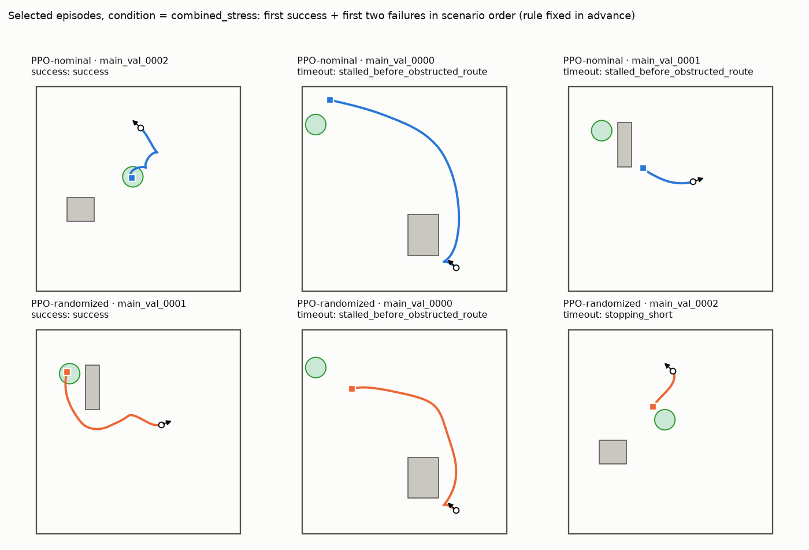
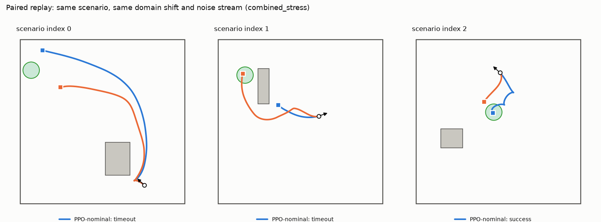
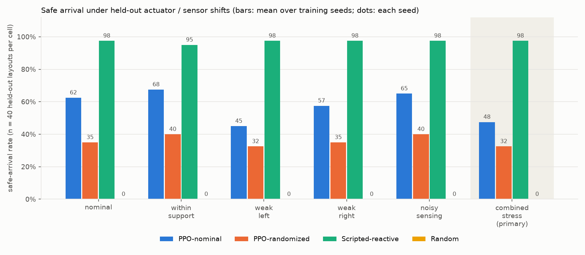
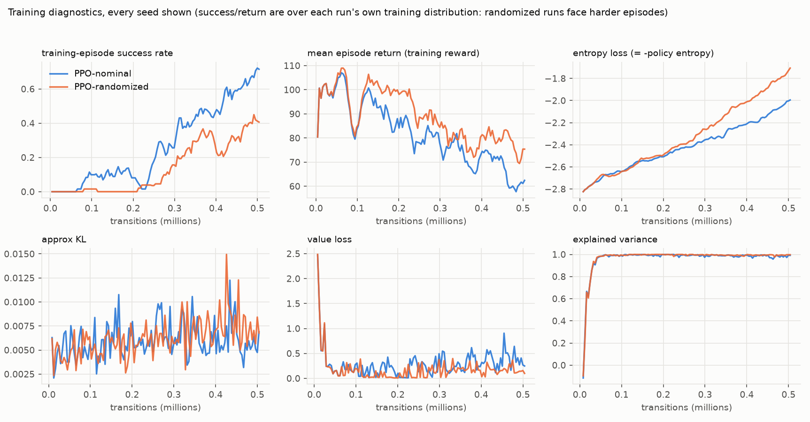

# RoboRobust results -- suite `val`

> **PRELIMINARY**: fewer than three training seeds per condition. 
> **Simulation only.** No physical robot, no sim-to-real claim. Goal position and velocities are privileged simulator inputs; the policy is a feedforward MLP. All numbers below are computed from `episode_results.jsonl`.

## Hypothesis and design

Hypothesis: a PPO policy trained with modest variation in wheel-motor strength and range-sensor noise (*PPO-randomized*) has a higher safe-arrival rate under held-out actuator and sensor shifts than a PPO policy trained under nominal conditions (*PPO-nominal*), possibly at a nominal-performance cost. Both conditions share the same PPO settings, reward, scenario distribution, seeds and transition budget. Because the intervention is *combined* (motor + noise), any effect is attributed to the combined intervention, not to either component.

* Evaluation: 40 held-out layouts x 6 conditions x each policy, deterministic inference, paired scenarios and noise streams (eval_seed=777). Primary endpoint (specified before the final evaluation): safe-arrival rate under **combined_stress** on unseen layouts.
* Safe arrival = verifier success (within 0.30 m, <= 0.10 m/s for 5 consecutive control steps, no wall/obstacle contact). Timeouts at 600 control steps (30 s) are an external cutoff.

Evaluation episodes: 960 (24 policy x seed x condition cells). Complete: **True**.

## Primary endpoint and secondary conditions

Safe-arrival rate, mean over training seeds (40 episodes per seed per cell; `combined_stress` is primary):

| policy | nominal | within_support | weak_left | weak_right | noisy_sensing | combined_stress |
|---|---|---|---|---|---|---|
| PPO-nominal | 62.5% | 67.5% | 45.0% | 57.5% | 65.0% | 47.5% |
| PPO-randomized | 35.0% | 40.0% | 32.5% | 35.0% | 40.0% | 32.5% |
| Scripted-reactive | 97.5% | 95.0% | 97.5% | 97.5% | 97.5% | 97.5% |
| Random | 0.0% | 0.0% | 0.0% | 0.0% | 0.0% | 0.0% |

Per-seed values and spread (std across training seeds, in percentage points):

| policy | condition | n_seeds | per_seed | std_over_seeds_pp | pooled_successes | pooled_episodes |
|---|---|---|---|---|---|---|
| nominal | nominal | 1 | 62% | n/a (1 seed) | 25 | 40 |
| nominal | within_support | 1 | 68% | n/a (1 seed) | 27 | 40 |
| nominal | weak_left | 1 | 45% | n/a (1 seed) | 18 | 40 |
| nominal | weak_right | 1 | 57% | n/a (1 seed) | 23 | 40 |
| nominal | noisy_sensing | 1 | 65% | n/a (1 seed) | 26 | 40 |
| nominal | combined_stress | 1 | 48% | n/a (1 seed) | 19 | 40 |
| randomized | nominal | 1 | 35% | n/a (1 seed) | 14 | 40 |
| randomized | within_support | 1 | 40% | n/a (1 seed) | 16 | 40 |
| randomized | weak_left | 1 | 32% | n/a (1 seed) | 13 | 40 |
| randomized | weak_right | 1 | 35% | n/a (1 seed) | 14 | 40 |
| randomized | noisy_sensing | 1 | 40% | n/a (1 seed) | 16 | 40 |
| randomized | combined_stress | 1 | 32% | n/a (1 seed) | 13 | 40 |
| scripted | nominal | 1 | 98% | n/a (1 seed) | 39 | 40 |
| scripted | within_support | 1 | 95% | n/a (1 seed) | 38 | 40 |
| scripted | weak_left | 1 | 98% | n/a (1 seed) | 39 | 40 |
| scripted | weak_right | 1 | 98% | n/a (1 seed) | 39 | 40 |
| scripted | noisy_sensing | 1 | 98% | n/a (1 seed) | 39 | 40 |
| scripted | combined_stress | 1 | 98% | n/a (1 seed) | 39 | 40 |
| random | nominal | 1 | 0% | n/a (1 seed) | 0 | 40 |
| random | within_support | 1 | 0% | n/a (1 seed) | 0 | 40 |
| random | weak_left | 1 | 0% | n/a (1 seed) | 0 | 40 |
| random | weak_right | 1 | 0% | n/a (1 seed) | 0 | 40 |
| random | noisy_sensing | 1 | 0% | n/a (1 seed) | 0 | 40 |
| random | combined_stress | 1 | 0% | n/a (1 seed) | 0 | 40 |

Per-seed Wilson 95% intervals describe uncertainty over the sampled *scenarios* only; they do not capture training-seed variability:

| policy | training_seed | condition | successes | n_episodes | success_rate | wilson_95 |
|---|---|---|---|---|---|---|
| nominal | 0.000 | nominal | 25 | 40 | 62.5% | [47%, 76%] |
| nominal | 0.000 | within_support | 27 | 40 | 67.5% | [52%, 80%] |
| nominal | 0.000 | weak_left | 18 | 40 | 45.0% | [31%, 60%] |
| nominal | 0.000 | weak_right | 23 | 40 | 57.5% | [42%, 71%] |
| nominal | 0.000 | noisy_sensing | 26 | 40 | 65.0% | [50%, 78%] |
| nominal | 0.000 | combined_stress | 19 | 40 | 47.5% | [33%, 63%] |
| randomized | 0.000 | nominal | 14 | 40 | 35.0% | [22%, 50%] |
| randomized | 0.000 | within_support | 16 | 40 | 40.0% | [26%, 55%] |
| randomized | 0.000 | weak_left | 13 | 40 | 32.5% | [20%, 48%] |
| randomized | 0.000 | weak_right | 14 | 40 | 35.0% | [22%, 50%] |
| randomized | 0.000 | noisy_sensing | 16 | 40 | 40.0% | [26%, 55%] |
| randomized | 0.000 | combined_stress | 13 | 40 | 32.5% | [20%, 48%] |
| scripted |  | nominal | 39 | 40 | 97.5% | [87%, 100%] |
| scripted |  | within_support | 38 | 40 | 95.0% | [83%, 99%] |
| scripted |  | weak_left | 39 | 40 | 97.5% | [87%, 100%] |
| scripted |  | weak_right | 39 | 40 | 97.5% | [87%, 100%] |
| scripted |  | noisy_sensing | 39 | 40 | 97.5% | [87%, 100%] |
| scripted |  | combined_stress | 39 | 40 | 97.5% | [87%, 100%] |
| random |  | nominal | 0 | 40 | 0.0% | [0%, 9%] |
| random |  | within_support | 0 | 40 | 0.0% | [0%, 9%] |
| random |  | weak_left | 0 | 40 | 0.0% | [0%, 9%] |
| random |  | weak_right | 0 | 40 | 0.0% | [0%, 9%] |
| random |  | noisy_sensing | 0 | 40 | 0.0% | [0%, 9%] |
| random |  | combined_stress | 0 | 40 | 0.0% | [0%, 9%] |

## Paired comparison: PPO-randomized minus PPO-nominal

Bootstrap over scenario IDs (10,000 resamples; the same resampled IDs are used for both policies, so the pairing is retained). `scenario` interval averages over training seeds and resamples scenarios only. `hierarchical` additionally resamples training seeds independently within each policy; with few seeds it is **exploratory** and limited in precision.

| condition | diff (pp) | scenario 95% (pp) | hierarchical 95% (pp) |
|---|---|---|---|
| nominal | -27.500 | [-50.0, -5.0] | n/a (<2 seeds) |
| within_support | -27.500 | [-47.5, -7.5] | n/a (<2 seeds) |
| weak_left | -12.500 | [-32.5, 7.5] | n/a (<2 seeds) |
| weak_right | -22.500 | [-45.0, 0.0] | n/a (<2 seeds) |
| noisy_sensing | -25.000 | [-47.5, -2.5] | n/a (<2 seeds) |
| combined_stress | -15.000 | [-35.0, 5.0] | n/a (<2 seeds) |

**Primary endpoint reading (combined_stress):** difference -15.0 pp, scenario-only 95% interval [-35.0, 5.0] pp, which includes zero. This is a statement about these seeds and these 50 layouts under simulated shifts; it is not evidence about hardware.

Because the hypothesis was not supported on the primary endpoint, the explanations below are **candidates that were not tested here** (see `REPORT.md` §Limits for the discriminating follow-up): slower convergence under randomization at this transition budget (compare `learning_curves.png`); the hidden-parameter / noisy-observation problem being partially observed for a feedforward policy; stress levels the nominal policy already tolerates; seed-to-seed variance exceeding the effect.

## Baselines

| policy | nominal | within_support | weak_left | weak_right | noisy_sensing | combined_stress |
|---|---|---|---|---|---|---|
| Scripted-reactive | 97.5% | 95.0% | 97.5% | 97.5% | 97.5% | 97.5% |
| Random | 0.0% | 0.0% | 0.0% | 0.0% | 0.0% | 0.0% |

The scripted reactive controller uses the same 29-element observation as PPO and no map. Its score is a measure of task difficulty for a hand-coded controller and bounds how much headroom RL has on this task; random is a sanity floor.

## Outcome breakdown, durations and path lengths

Outcomes sum to the episode count in every cell (checked). Durations cover all outcomes; time-to-goal and success path length use successes only (n shown); failure path length is separate. Return columns are **training reward, not task performance**.

| policy | training_seed | condition | n_episodes | successes | collisions | timeouts | other_failures | duration_mean_s_all | time_to_goal_mean_s_successes | n_time_to_goal | path_length_mean_m_successes | path_length_mean_m_failures | TRAINING_REWARD_return_mean |
|---|---|---|---|---|---|---|---|---|---|---|---|---|---|
| nominal | 0.00 | nominal | 40 | 25 | 4 | 11 | 0 | 17.17 | 14.04 | 25 | 4.63 | 1.50 | 64.10 |
| nominal | 0.00 | within_support | 40 | 27 | 2 | 11 | 0 | 17.66 | 13.82 | 27 | 4.60 | 1.71 | 67.81 |
| nominal | 0.00 | weak_left | 40 | 18 | 8 | 14 | 0 | 18.83 | 14.73 | 18 | 4.30 | 2.86 | 67.80 |
| nominal | 0.00 | weak_right | 40 | 23 | 5 | 12 | 0 | 19.59 | 17.61 | 23 | 4.92 | 2.49 | 63.57 |
| nominal | 0.00 | noisy_sensing | 40 | 26 | 4 | 10 | 0 | 16.85 | 14.17 | 26 | 4.71 | 1.53 | 63.20 |
| nominal | 0.00 | combined_stress | 40 | 19 | 7 | 14 | 0 | 19.41 | 15.46 | 19 | 4.30 | 2.94 | 68.97 |
| randomized | 0.00 | nominal | 40 | 14 | 5 | 21 | 0 | 20.70 | 13.36 | 14 | 3.59 | 2.49 | 63.66 |
| randomized | 0.00 | within_support | 40 | 16 | 5 | 19 | 0 | 20.14 | 13.84 | 16 | 3.61 | 2.65 | 63.26 |
| randomized | 0.00 | weak_left | 40 | 13 | 4 | 23 | 0 | 22.33 | 14.32 | 13 | 3.62 | 3.02 | 68.93 |
| randomized | 0.00 | weak_right | 40 | 14 | 3 | 23 | 0 | 22.33 | 14.16 | 14 | 3.59 | 2.82 | 67.96 |
| randomized | 0.00 | noisy_sensing | 40 | 16 | 5 | 19 | 0 | 19.98 | 13.65 | 16 | 3.62 | 2.42 | 64.25 |
| randomized | 0.00 | combined_stress | 40 | 13 | 4 | 23 | 0 | 22.43 | 14.64 | 13 | 3.62 | 3.05 | 69.01 |
| scripted |  | nominal | 40 | 39 | 0 | 1 | 0 | 14.70 | 14.31 | 39 | 3.51 | 4.30 | 65.39 |
| scripted |  | within_support | 40 | 38 | 1 | 1 | 0 | 14.63 | 14.20 | 38 | 3.51 | 3.24 | 64.88 |
| scripted |  | weak_left | 40 | 39 | 0 | 1 | 0 | 15.49 | 15.12 | 39 | 3.54 | 3.26 | 67.65 |
| scripted |  | weak_right | 40 | 39 | 0 | 1 | 0 | 15.21 | 14.83 | 39 | 3.53 | 5.04 | 67.20 |
| scripted |  | noisy_sensing | 40 | 39 | 0 | 1 | 0 | 14.28 | 13.88 | 39 | 3.52 | 4.08 | 63.72 |
| scripted |  | combined_stress | 40 | 39 | 0 | 1 | 0 | 14.92 | 14.54 | 39 | 3.53 | 3.43 | 65.79 |
| random |  | nominal | 40 | 0 | 2 | 38 | 0 | 28.72 |  | 0 |  | 1.97 | 114.34 |
| random |  | within_support | 40 | 0 | 2 | 38 | 0 | 29.39 |  | 0 |  | 1.99 | 118.46 |
| random |  | weak_left | 40 | 0 | 2 | 38 | 0 | 29.61 |  | 0 |  | 1.74 | 119.82 |
| random |  | weak_right | 40 | 0 | 2 | 38 | 0 | 29.52 |  | 0 |  | 1.72 | 118.42 |
| random |  | noisy_sensing | 40 | 0 | 3 | 37 | 0 | 28.89 |  | 0 |  | 2.01 | 117.89 |
| random |  | combined_stress | 40 | 0 | 2 | 38 | 0 | 29.70 |  | 0 |  | 1.77 | 119.85 |

## Failure taxonomy (automatic tags, multi-label)

Heuristic tags from logged episode features; thresholds: `turning_yaw_rate`=0.8, `passage_clearance`=0.9, `stop_speed`=0.02, `short_band`=0.75, `circling_yaw_travel`=12.6, `drift_yaw_rate`=0.1, `drift_min_steps`=20, `asymmetry`=0.2. `stalled_before_obstructed_route` is an extra tag (stopped far from the goal when the straight line was blocked). Tags are defensible heuristics, not ground-truth causes; manual labels can be merged with `--manual-labels`.

| policy | condition | episodes | failures | collision_near_passage | stalled_before_obstructed_route | stopping_short | timeout_despite_clear_route | unclassified | collision_while_turning | motor_asymmetry_drift | circling_oscillation |
|---|---|---|---|---|---|---|---|---|---|---|---|
| nominal | nominal | 40 | 15 | 1 | 8 | 2 | 1 | 3 | 0 | 0 | 0 |
| nominal | within_support | 40 | 13 | 0 | 8 | 1 | 1 | 3 | 0 | 0 | 0 |
| nominal | weak_left | 40 | 22 | 0 | 8 | 1 | 1 | 8 | 1 | 4 | 0 |
| nominal | weak_right | 40 | 17 | 0 | 5 | 2 | 2 | 8 | 0 | 0 | 0 |
| nominal | noisy_sensing | 40 | 14 | 1 | 6 | 2 | 1 | 4 | 0 | 0 | 0 |
| nominal | combined_stress | 40 | 21 | 0 | 6 | 1 | 1 | 9 | 1 | 4 | 0 |
| random | nominal | 40 | 40 | 2 | 2 | 0 | 13 | 1 | 0 | 0 | 37 |
| random | within_support | 40 | 40 | 2 | 6 | 0 | 13 | 0 | 0 | 11 | 37 |
| random | weak_left | 40 | 40 | 0 | 5 | 0 | 13 | 11 | 0 | 15 | 8 |
| random | weak_right | 40 | 40 | 1 | 4 | 0 | 13 | 13 | 0 | 13 | 3 |
| random | noisy_sensing | 40 | 40 | 2 | 3 | 0 | 13 | 1 | 1 | 0 | 37 |
| random | combined_stress | 40 | 40 | 2 | 7 | 0 | 13 | 7 | 0 | 20 | 2 |
| randomized | nominal | 40 | 26 | 0 | 7 | 7 | 6 | 6 | 0 | 0 | 0 |
| randomized | within_support | 40 | 24 | 0 | 6 | 6 | 5 | 6 | 0 | 1 | 0 |
| randomized | weak_left | 40 | 27 | 0 | 10 | 5 | 5 | 7 | 0 | 1 | 0 |
| randomized | weak_right | 40 | 26 | 0 | 7 | 8 | 5 | 5 | 0 | 3 | 0 |
| randomized | noisy_sensing | 40 | 24 | 0 | 6 | 5 | 5 | 8 | 0 | 0 | 0 |
| randomized | combined_stress | 40 | 27 | 0 | 9 | 4 | 5 | 9 | 0 | 1 | 0 |
| scripted | nominal | 40 | 1 | 0 | 0 | 0 | 0 | 0 | 0 | 0 | 1 |
| scripted | within_support | 40 | 2 | 0 | 0 | 0 | 0 | 1 | 0 | 0 | 1 |
| scripted | weak_left | 40 | 1 | 0 | 0 | 0 | 0 | 0 | 0 | 0 | 1 |
| scripted | weak_right | 40 | 1 | 0 | 0 | 0 | 0 | 0 | 0 | 0 | 1 |
| scripted | noisy_sensing | 40 | 1 | 0 | 0 | 0 | 0 | 0 | 0 | 0 | 1 |
| scripted | combined_stress | 40 | 1 | 0 | 0 | 0 | 0 | 0 | 0 | 0 | 1 |

## Selected episodes

Rule, fixed before results: in `combined_stress`, for training seed 0 of each learned policy: the first success and the first two failures by scenario order. Paired replays use the first three scenarios, pinned in the suite config before evaluation.

* PPO-nominal: `nominal_s0__combined_stress__main_val_0002`, `nominal_s0__combined_stress__main_val_0000`, `nominal_s0__combined_stress__main_val_0001`
* PPO-randomized: `randomized_s0__combined_stress__main_val_0001`, `randomized_s0__combined_stress__main_val_0000`, `randomized_s0__combined_stress__main_val_0002`

## Comparison and learning curves

Learning curves are diagnostics, not task results: the success/return panels are measured on each run's own *training* distribution (randomized runs face harder episodes) with stochastic actions.

## Training cost

| policy | training_seed | run_id | train_transitions | train_wallclock_s |
|---|---|---|---|---|
| nominal | 0 | dev_main_nominal_s0 | 503808 | 82 |
| randomized | 0 | dev_main_randomized_s0 | 503808 | 82 |

Wall-clock is as measured on the training machine, with other runs in parallel; it is not a clean throughput benchmark (see `results/benchmark.json`).

## Reproducibility table

| item | value |
|---|---|
| evaluation suite sha256 | d61fb1ec02a4c43c |
| test/val manifest sha256 | 10a2cc8b0e1e39a4 |
| environment+robot.xml hash | ab4c9192e41344b6-9370d167 |
| source code hash | 9de4257209f9a23c |
| git commit | HEAD (dirty) |
| python / platform | 3.11.15 / macOS-26.6.2-arm64-arm-64bit |
| package mujoco | 3.16.0 |
| package gymnasium | 1.4.0 |
| package stable-baselines3 | 2.9.0 |
| package torch | 2.14.1 |
| package numpy | 2.4.6 |
| package pandas | 3.0.6 |
| package matplotlib | 3.11.2 |
| package pyyaml | 6.0.3 |
| package pytest | 9.1.1 |

| run_id | policy | training_seed | checkpoint_sha256 |
|---|---|---|---|
| dev_main_nominal_s0 | nominal | 0.000 | 676c2eeea4412cf9 |
| dev_main_randomized_s0 | randomized | 0.000 | 463525d9ed5eaf90 |
| baseline:scripted | scripted |  | n/a |
| baseline:random | random |  | n/a |

## Integrity checks (Gate D)

* all expected episode records present: **True**; reconciled counts per cell: outcomes sum to episodes; success flags agree with terminal reasons; noise seeds shared across policies for every (scenario, condition); single manifest and environment hash.
* aggregate tables above are computed from the raw JSONL and re-checked against it before this file is written.

## Limits

* Simulation only. Sim-to-real transfer and general robotics superiority are not tested.
* Goal localisation and velocity are privileged simulator-derived inputs; range noise touches only the 24 range readings.
* Stress levels are proposed values, not calibrated hardware distributions; the 0.6 motor multiplier bites mainly under demanding (near-saturating) commands.
* Hidden motor gains + noisy ranges make the task partially observed; the policy is feedforward by design.
* Grid connectivity is an approximate feasibility check, not a guarantee of dynamic solvability.
* One combined intervention: no attribution to motor randomization versus noise randomization.
* Few training seeds: bootstrap intervals over seeds are exploratory. Scenarios (not timesteps, not repeated evaluations) are the resampling unit.
* A discriminating follow-up experiment: train both conditions to convergence with a longer budget (or a memory-equipped policy) and re-run this exact suite on a *newly generated* held-out set.
