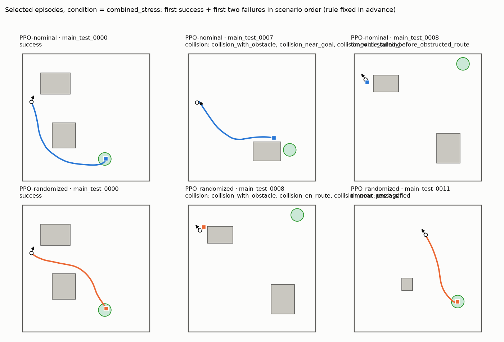
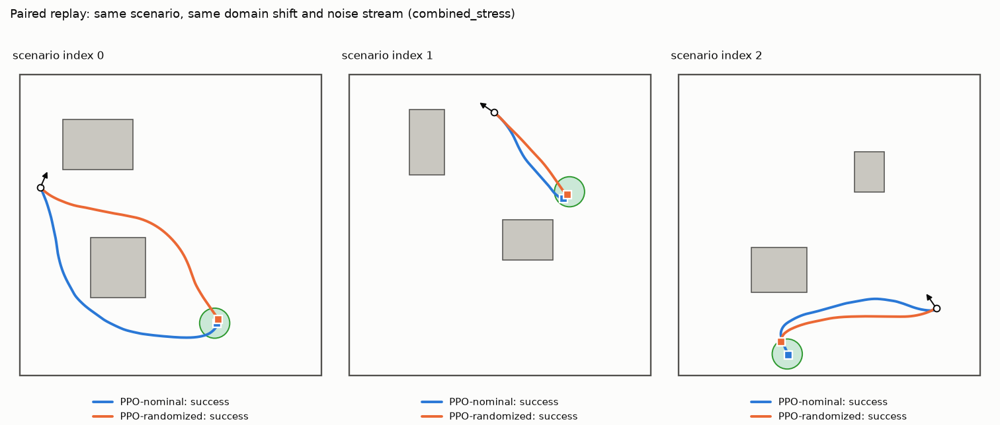
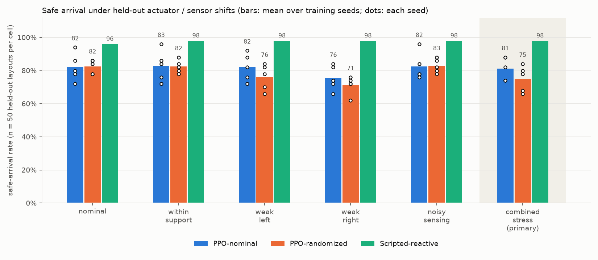

# RoboRobust results -- suite `test`

> 5 training seeds per condition (intervals over seeds are exploratory).
> **Simulation only.** No physical robot, no sim-to-real claim. Goal position and velocities are privileged simulator inputs; the policy is a feedforward MLP. All numbers below are computed from `episode_results.jsonl`.

## Hypothesis and design

Hypothesis: a PPO policy trained with modest variation in wheel-motor strength and range-sensor noise (*PPO-randomized*) has a higher safe-arrival rate under held-out actuator and sensor shifts than a PPO policy trained under nominal conditions (*PPO-nominal*), possibly at a nominal-performance cost. Both conditions share the same PPO settings, reward, scenario distribution, seeds and transition budget. Because the intervention is *combined* (motor + noise), any effect is attributed to the combined intervention, not to either component.

* Evaluation: 50 held-out layouts x 6 conditions x each policy, deterministic inference, paired scenarios and noise streams (eval_seed=20260601). Primary endpoint (specified before the final evaluation): safe-arrival rate under **combined_stress** on unseen layouts.
* Safe arrival = verifier success (within 0.30 m, <= 0.10 m/s for 5 consecutive control steps, no wall/obstacle contact). Timeouts at 600 control steps (30 s) are an external cutoff.

Evaluation episodes: 3300 (66 policy x seed x condition cells). Complete: **True**.

## Primary endpoint and secondary conditions

Safe-arrival rate, mean over training seeds (50 episodes per seed per cell; `combined_stress` is primary):

| policy | nominal | within_support | weak_left | weak_right | noisy_sensing | combined_stress |
|---|---|---|---|---|---|---|
| PPO-nominal | 82.0% | 82.8% | 82.0% | 75.6% | 82.4% | 81.2% |
| PPO-randomized | 82.4% | 82.4% | 76.0% | 71.2% | 82.8% | 75.2% |
| Scripted-reactive | 96.0% | 98.0% | 98.0% | 98.0% | 98.0% | 98.0% |

Per-seed values and spread (std across training seeds, in percentage points):

| policy | condition | n_seeds | per_seed | std_over_seeds_pp | pooled_successes | pooled_episodes |
|---|---|---|---|---|---|---|
| nominal | nominal | 5 | 94%, 86%, 78%, 72%, 80% | 8.4 | 205 | 250 |
| nominal | within_support | 5 | 96%, 84%, 72%, 76%, 86% | 9.3 | 207 | 250 |
| nominal | weak_left | 5 | 88%, 92%, 72%, 76%, 82% | 8.2 | 205 | 250 |
| nominal | weak_right | 5 | 84%, 72%, 82%, 74%, 66% | 7.4 | 189 | 250 |
| nominal | noisy_sensing | 5 | 96%, 84%, 78%, 76%, 78% | 8.2 | 206 | 250 |
| nominal | combined_stress | 5 | 88%, 88%, 74%, 74%, 82% | 7.0 | 203 | 250 |
| randomized | nominal | 5 | 78%, 78%, 84%, 86%, 86% | 4.1 | 206 | 250 |
| randomized | within_support | 5 | 80%, 82%, 78%, 88%, 84% | 3.8 | 206 | 250 |
| randomized | weak_left | 5 | 78%, 84%, 66%, 70%, 82% | 7.7 | 190 | 250 |
| randomized | weak_right | 5 | 62%, 72%, 74%, 76%, 72% | 5.4 | 178 | 250 |
| randomized | noisy_sensing | 5 | 80%, 78%, 82%, 88%, 86% | 4.1 | 207 | 250 |
| randomized | combined_stress | 5 | 78%, 84%, 66%, 68%, 80% | 7.8 | 188 | 250 |
| scripted | nominal | 1 | 96% | n/a (1 seed) | 48 | 50 |
| scripted | within_support | 1 | 98% | n/a (1 seed) | 49 | 50 |
| scripted | weak_left | 1 | 98% | n/a (1 seed) | 49 | 50 |
| scripted | weak_right | 1 | 98% | n/a (1 seed) | 49 | 50 |
| scripted | noisy_sensing | 1 | 98% | n/a (1 seed) | 49 | 50 |
| scripted | combined_stress | 1 | 98% | n/a (1 seed) | 49 | 50 |

Per-seed Wilson 95% intervals describe uncertainty over the sampled *scenarios* only; they do not capture training-seed variability:

| policy | seed | condition | successes | n_episodes | success_rate | wilson_95 |
|---|---|---|---|---|---|---|
| nominal | 0 | nominal | 47 | 50 | 94.0% | [84%, 98%] |
| nominal | 0 | within_support | 48 | 50 | 96.0% | [87%, 99%] |
| nominal | 0 | weak_left | 44 | 50 | 88.0% | [76%, 94%] |
| nominal | 0 | weak_right | 42 | 50 | 84.0% | [71%, 92%] |
| nominal | 0 | noisy_sensing | 48 | 50 | 96.0% | [87%, 99%] |
| nominal | 0 | combined_stress | 44 | 50 | 88.0% | [76%, 94%] |
| nominal | 1 | nominal | 43 | 50 | 86.0% | [74%, 93%] |
| nominal | 1 | within_support | 42 | 50 | 84.0% | [71%, 92%] |
| nominal | 1 | weak_left | 46 | 50 | 92.0% | [81%, 97%] |
| nominal | 1 | weak_right | 36 | 50 | 72.0% | [58%, 83%] |
| nominal | 1 | noisy_sensing | 42 | 50 | 84.0% | [71%, 92%] |
| nominal | 1 | combined_stress | 44 | 50 | 88.0% | [76%, 94%] |
| nominal | 2 | nominal | 39 | 50 | 78.0% | [65%, 87%] |
| nominal | 2 | within_support | 36 | 50 | 72.0% | [58%, 83%] |
| nominal | 2 | weak_left | 36 | 50 | 72.0% | [58%, 83%] |
| nominal | 2 | weak_right | 41 | 50 | 82.0% | [69%, 90%] |
| nominal | 2 | noisy_sensing | 39 | 50 | 78.0% | [65%, 87%] |
| nominal | 2 | combined_stress | 37 | 50 | 74.0% | [60%, 84%] |
| nominal | 3 | nominal | 36 | 50 | 72.0% | [58%, 83%] |
| nominal | 3 | within_support | 38 | 50 | 76.0% | [63%, 86%] |
| nominal | 3 | weak_left | 38 | 50 | 76.0% | [63%, 86%] |
| nominal | 3 | weak_right | 37 | 50 | 74.0% | [60%, 84%] |
| nominal | 3 | noisy_sensing | 38 | 50 | 76.0% | [63%, 86%] |
| nominal | 3 | combined_stress | 37 | 50 | 74.0% | [60%, 84%] |
| nominal | 4 | nominal | 40 | 50 | 80.0% | [67%, 89%] |
| nominal | 4 | within_support | 43 | 50 | 86.0% | [74%, 93%] |
| nominal | 4 | weak_left | 41 | 50 | 82.0% | [69%, 90%] |
| nominal | 4 | weak_right | 33 | 50 | 66.0% | [52%, 78%] |
| nominal | 4 | noisy_sensing | 39 | 50 | 78.0% | [65%, 87%] |
| nominal | 4 | combined_stress | 41 | 50 | 82.0% | [69%, 90%] |
| randomized | 0 | nominal | 39 | 50 | 78.0% | [65%, 87%] |
| randomized | 0 | within_support | 40 | 50 | 80.0% | [67%, 89%] |
| randomized | 0 | weak_left | 39 | 50 | 78.0% | [65%, 87%] |
| randomized | 0 | weak_right | 31 | 50 | 62.0% | [48%, 74%] |
| randomized | 0 | noisy_sensing | 40 | 50 | 80.0% | [67%, 89%] |
| randomized | 0 | combined_stress | 39 | 50 | 78.0% | [65%, 87%] |
| randomized | 1 | nominal | 39 | 50 | 78.0% | [65%, 87%] |
| randomized | 1 | within_support | 41 | 50 | 82.0% | [69%, 90%] |
| randomized | 1 | weak_left | 42 | 50 | 84.0% | [71%, 92%] |
| randomized | 1 | weak_right | 36 | 50 | 72.0% | [58%, 83%] |
| randomized | 1 | noisy_sensing | 39 | 50 | 78.0% | [65%, 87%] |
| randomized | 1 | combined_stress | 42 | 50 | 84.0% | [71%, 92%] |
| randomized | 2 | nominal | 42 | 50 | 84.0% | [71%, 92%] |
| randomized | 2 | within_support | 39 | 50 | 78.0% | [65%, 87%] |
| randomized | 2 | weak_left | 33 | 50 | 66.0% | [52%, 78%] |
| randomized | 2 | weak_right | 37 | 50 | 74.0% | [60%, 84%] |
| randomized | 2 | noisy_sensing | 41 | 50 | 82.0% | [69%, 90%] |
| randomized | 2 | combined_stress | 33 | 50 | 66.0% | [52%, 78%] |
| randomized | 3 | nominal | 43 | 50 | 86.0% | [74%, 93%] |
| randomized | 3 | within_support | 44 | 50 | 88.0% | [76%, 94%] |
| randomized | 3 | weak_left | 35 | 50 | 70.0% | [56%, 81%] |
| randomized | 3 | weak_right | 38 | 50 | 76.0% | [63%, 86%] |
| randomized | 3 | noisy_sensing | 44 | 50 | 88.0% | [76%, 94%] |
| randomized | 3 | combined_stress | 34 | 50 | 68.0% | [54%, 79%] |
| randomized | 4 | nominal | 43 | 50 | 86.0% | [74%, 93%] |
| randomized | 4 | within_support | 42 | 50 | 84.0% | [71%, 92%] |
| randomized | 4 | weak_left | 41 | 50 | 82.0% | [69%, 90%] |
| randomized | 4 | weak_right | 36 | 50 | 72.0% | [58%, 83%] |
| randomized | 4 | noisy_sensing | 43 | 50 | 86.0% | [74%, 93%] |
| randomized | 4 | combined_stress | 40 | 50 | 80.0% | [67%, 89%] |
| scripted | - | nominal | 48 | 50 | 96.0% | [87%, 99%] |
| scripted | - | within_support | 49 | 50 | 98.0% | [90%, 100%] |
| scripted | - | weak_left | 49 | 50 | 98.0% | [90%, 100%] |
| scripted | - | weak_right | 49 | 50 | 98.0% | [90%, 100%] |
| scripted | - | noisy_sensing | 49 | 50 | 98.0% | [90%, 100%] |
| scripted | - | combined_stress | 49 | 50 | 98.0% | [90%, 100%] |

## Paired comparison: PPO-randomized minus PPO-nominal

Bootstrap over scenario IDs (10,000 resamples; the same resampled IDs are used for both policies, so the pairing is retained). `scenario` interval averages over training seeds and resamples scenarios only. `hierarchical` additionally resamples training seeds independently within each policy; with few seeds it is **exploratory** and limited in precision.

| condition | diff (pp) | scenario 95% (pp) | hierarchical 95% (pp) |
|---|---|---|---|
| nominal | 0.4 | [-5.6, 6.0] | [-10.4, 11.2] |
| within_support | -0.4 | [-4.8, 4.0] | [-10.8, 10.0] |
| weak_left | -6.0 | [-12.0, 0.0] | [-18.4, 5.6] |
| weak_right | -4.4 | [-10.8, 2.0] | [-16.4, 7.2] |
| noisy_sensing | 0.4 | [-4.4, 5.2] | [-9.6, 10.8] |
| combined_stress | -6.0 | [-12.4, 0.4] | [-18.0, 5.6] |

**Primary endpoint reading (combined_stress):** difference -6.0 pp (randomized minus nominal). Scenario-only 95% interval [-12.4, 0.4] pp; hierarchical (seeds and scenarios) 95% interval [-18.0, 5.6] pp, which includes zero. This is a statement about these seeds and these held-out layouts under simulated shifts; it is not evidence about hardware.

The data show no advantage for randomization on the primary endpoint; an interval that includes zero means no difference could be detected, not that none exists. Candidate explanations listed here were **not tested** (§Limits gives a discriminating follow-up): stress levels that the nominal policy already largely tolerates; a hidden-parameter / noisy-observation problem that is partially observed for a feedforward policy; a transition budget at which neither policy has converged to its robust form; seed-to-seed variance larger than the effect.

### Exploratory (not pre-specified): robustness gap

Each policy's drop from its own nominal-condition score to a shifted condition, and the difference of the two drops (`did` > 0: the randomized policy loses *less* than the nominal policy; < 0: more). Same bootstrap as above (scenario IDs shared across all four cells). Added after seeing validation behaviour to match the hypothesis's wording about robustness under shifts and a possible nominal-performance trade-off; treat intervals that include zero as no evidence either way.

| condition | randomized drop (pp) | nominal drop (pp) | did (pp) | scenario 95% (pp) | hierarchical 95% (pp) |
|---|---|---|---|---|---|
| within_support | 0.0 | -0.8 | -0.8 | [-5.2, 3.2] | [-9.2, 6.8] |
| weak_left | 6.4 | 0.0 | -6.4 | [-14.8, 1.6] | [-21.6, 7.2] |
| weak_right | 11.2 | 6.4 | -4.8 | [-13.2, 2.8] | [-18.8, 8.0] |
| noisy_sensing | -0.4 | -0.4 | 0.0 | [-3.2, 3.2] | [-5.2, 5.2] |
| combined_stress | 7.2 | 0.8 | -6.4 | [-15.2, 2.4] | [-21.2, 7.6] |

## Baselines

| policy | nominal | within_support | weak_left | weak_right | noisy_sensing | combined_stress |
|---|---|---|---|---|---|---|
| Scripted-reactive | 96.0% | 98.0% | 98.0% | 98.0% | 98.0% | 98.0% |

The scripted reactive controller uses the same 29-element observation as PPO and no map. Its score is a measure of task difficulty for a hand-coded controller and bounds how much headroom RL has on this task; random is a sanity floor.

## Outcome breakdown, durations and path lengths

Outcomes sum to the episode count in every cell (checked). Durations cover all outcomes; time-to-goal and success path length use successes only (n shown); failure path length is separate. Return columns are **training reward, not task performance**.

| policy | seed | condition | n_episodes | successes | collisions | timeouts | other_failures | duration_mean_s_all | time_to_goal_mean_s_successes | n_time_to_goal | path_length_mean_m_successes | path_length_mean_m_failures | TRAINING_REWARD_return_mean |
|---|---|---|---|---|---|---|---|---|---|---|---|---|---|
| nominal | 0 | nominal | 50 | 47 | 1 | 2 | 0 | 11.67 | 10.99 | 47 | 4.05 | 1.63 | 29.94 |
| nominal | 0 | within_support | 50 | 48 | 1 | 1 | 0 | 11.53 | 11.24 | 48 | 4.08 | 1.21 | 30.36 |
| nominal | 0 | weak_left | 50 | 44 | 5 | 1 | 0 | 12.98 | 13.12 | 44 | 4.04 | 2.32 | 29.02 |
| nominal | 0 | weak_right | 50 | 42 | 2 | 6 | 0 | 14.68 | 12.69 | 42 | 3.98 | 3.59 | 28.53 |
| nominal | 0 | noisy_sensing | 50 | 48 | 1 | 1 | 0 | 11.35 | 11.05 | 48 | 4.07 | 1.27 | 30.36 |
| nominal | 0 | combined_stress | 50 | 44 | 5 | 1 | 0 | 12.90 | 13.02 | 44 | 4.04 | 2.34 | 29.03 |
| nominal | 1 | nominal | 50 | 43 | 5 | 2 | 0 | 11.74 | 11.36 | 43 | 4.25 | 2.66 | 28.77 |
| nominal | 1 | within_support | 50 | 42 | 7 | 1 | 0 | 10.83 | 11.17 | 42 | 4.16 | 2.37 | 28.35 |
| nominal | 1 | weak_left | 50 | 46 | 4 | 0 | 0 | 11.80 | 12.47 | 46 | 4.03 | 1.15 | 29.90 |
| nominal | 1 | weak_right | 50 | 36 | 13 | 1 | 0 | 12.53 | 14.67 | 36 | 4.43 | 1.81 | 26.20 |
| nominal | 1 | noisy_sensing | 50 | 42 | 7 | 1 | 0 | 11.24 | 11.33 | 42 | 4.23 | 2.55 | 28.42 |
| nominal | 1 | combined_stress | 50 | 44 | 6 | 0 | 0 | 11.63 | 12.44 | 44 | 4.02 | 1.74 | 29.12 |
| nominal | 2 | nominal | 50 | 39 | 2 | 9 | 0 | 14.49 | 11.46 | 39 | 4.15 | 4.40 | 27.69 |
| nominal | 2 | within_support | 50 | 36 | 5 | 9 | 0 | 13.57 | 10.69 | 36 | 3.89 | 4.00 | 26.62 |
| nominal | 2 | weak_left | 50 | 36 | 11 | 3 | 0 | 13.15 | 14.03 | 36 | 4.36 | 2.30 | 26.28 |
| nominal | 2 | weak_right | 50 | 41 | 7 | 2 | 0 | 12.58 | 13.01 | 41 | 3.90 | 2.41 | 28.03 |
| nominal | 2 | noisy_sensing | 50 | 39 | 2 | 9 | 0 | 14.21 | 11.09 | 39 | 4.08 | 4.47 | 27.75 |
| nominal | 2 | combined_stress | 50 | 37 | 11 | 2 | 0 | 12.53 | 14.01 | 37 | 4.36 | 2.08 | 26.63 |
| nominal | 3 | nominal | 50 | 36 | 5 | 9 | 0 | 13.88 | 11.03 | 36 | 4.07 | 3.90 | 26.65 |
| nominal | 3 | within_support | 50 | 38 | 4 | 8 | 0 | 13.86 | 11.37 | 38 | 4.13 | 3.78 | 27.27 |
| nominal | 3 | weak_left | 50 | 38 | 9 | 3 | 0 | 13.05 | 13.39 | 38 | 4.11 | 3.02 | 27.13 |
| nominal | 3 | weak_right | 50 | 37 | 8 | 5 | 0 | 13.33 | 12.76 | 37 | 3.98 | 2.56 | 26.62 |
| nominal | 3 | noisy_sensing | 50 | 38 | 5 | 7 | 0 | 13.01 | 10.89 | 38 | 4.06 | 3.71 | 27.25 |
| nominal | 3 | combined_stress | 50 | 37 | 9 | 4 | 0 | 13.35 | 13.35 | 37 | 4.14 | 3.18 | 26.86 |
| nominal | 4 | nominal | 50 | 40 | 8 | 2 | 0 | 11.25 | 11.32 | 40 | 4.10 | 3.32 | 27.51 |
| nominal | 4 | within_support | 50 | 43 | 6 | 1 | 0 | 10.98 | 11.45 | 43 | 4.21 | 1.87 | 28.60 |
| nominal | 4 | weak_left | 50 | 41 | 6 | 3 | 0 | 13.87 | 13.51 | 41 | 4.19 | 2.79 | 28.11 |
| nominal | 4 | weak_right | 50 | 33 | 15 | 2 | 0 | 12.80 | 14.30 | 33 | 4.36 | 2.80 | 24.98 |
| nominal | 4 | noisy_sensing | 50 | 39 | 8 | 3 | 0 | 11.46 | 11.09 | 39 | 4.03 | 3.65 | 27.27 |
| nominal | 4 | combined_stress | 50 | 41 | 6 | 3 | 0 | 13.86 | 13.52 | 41 | 4.19 | 2.82 | 28.10 |
| randomized | 0 | nominal | 50 | 39 | 4 | 7 | 0 | 13.00 | 11.14 | 39 | 3.99 | 3.43 | 27.60 |
| randomized | 0 | within_support | 50 | 40 | 5 | 5 | 0 | 11.94 | 10.95 | 40 | 3.99 | 2.41 | 27.64 |
| randomized | 0 | weak_left | 50 | 39 | 6 | 5 | 0 | 13.07 | 12.34 | 39 | 3.88 | 2.91 | 27.66 |
| randomized | 0 | weak_right | 50 | 31 | 9 | 10 | 0 | 15.19 | 13.80 | 31 | 4.15 | 3.07 | 24.85 |
| randomized | 0 | noisy_sensing | 50 | 40 | 4 | 6 | 0 | 12.33 | 10.78 | 40 | 3.90 | 3.35 | 27.77 |
| randomized | 0 | combined_stress | 50 | 39 | 6 | 5 | 0 | 13.01 | 12.27 | 39 | 3.88 | 2.92 | 27.65 |
| randomized | 1 | nominal | 50 | 39 | 6 | 5 | 0 | 11.89 | 10.81 | 39 | 4.10 | 2.38 | 27.29 |
| randomized | 1 | within_support | 50 | 41 | 4 | 5 | 0 | 12.19 | 10.87 | 41 | 4.06 | 2.62 | 28.07 |
| randomized | 1 | weak_left | 50 | 42 | 2 | 6 | 0 | 14.38 | 12.72 | 42 | 3.98 | 3.01 | 28.56 |
| randomized | 1 | weak_right | 50 | 36 | 12 | 2 | 0 | 12.88 | 14.38 | 36 | 4.44 | 1.90 | 26.06 |
| randomized | 1 | noisy_sensing | 50 | 39 | 7 | 4 | 0 | 11.36 | 10.79 | 39 | 4.03 | 2.13 | 27.17 |
| randomized | 1 | combined_stress | 50 | 42 | 2 | 6 | 0 | 14.13 | 12.43 | 42 | 3.96 | 3.07 | 28.60 |
| randomized | 2 | nominal | 50 | 42 | 6 | 2 | 0 | 11.71 | 12.07 | 42 | 4.41 | 1.87 | 28.18 |
| randomized | 2 | within_support | 50 | 39 | 6 | 5 | 0 | 12.51 | 11.62 | 39 | 4.30 | 2.79 | 27.22 |
| randomized | 2 | weak_left | 50 | 33 | 13 | 4 | 0 | 13.37 | 14.73 | 33 | 4.47 | 1.85 | 24.79 |
| randomized | 2 | weak_right | 50 | 37 | 9 | 4 | 0 | 12.52 | 12.28 | 37 | 3.84 | 3.14 | 26.75 |
| randomized | 2 | noisy_sensing | 50 | 41 | 5 | 4 | 0 | 12.38 | 11.76 | 41 | 4.37 | 2.89 | 28.06 |
| randomized | 2 | combined_stress | 50 | 33 | 13 | 4 | 0 | 13.36 | 14.71 | 33 | 4.46 | 1.91 | 24.78 |
| randomized | 3 | nominal | 50 | 43 | 5 | 2 | 0 | 11.72 | 11.73 | 43 | 4.39 | 2.78 | 28.57 |
| randomized | 3 | within_support | 50 | 44 | 5 | 1 | 0 | 11.66 | 12.13 | 44 | 4.48 | 1.46 | 28.76 |
| randomized | 3 | weak_left | 50 | 35 | 15 | 0 | 0 | 11.80 | 14.61 | 35 | 4.50 | 1.62 | 25.52 |
| randomized | 3 | weak_right | 50 | 38 | 7 | 5 | 0 | 15.34 | 15.11 | 38 | 4.64 | 3.52 | 27.07 |
| randomized | 3 | noisy_sensing | 50 | 44 | 5 | 1 | 0 | 11.66 | 12.08 | 44 | 4.46 | 2.37 | 28.86 |
| randomized | 3 | combined_stress | 50 | 34 | 16 | 0 | 0 | 11.60 | 14.38 | 34 | 4.41 | 1.76 | 25.12 |
| randomized | 4 | nominal | 50 | 43 | 4 | 3 | 0 | 11.39 | 10.82 | 43 | 3.97 | 1.89 | 28.40 |
| randomized | 4 | within_support | 50 | 42 | 5 | 3 | 0 | 11.12 | 10.67 | 42 | 3.94 | 2.60 | 28.41 |
| randomized | 4 | weak_left | 50 | 41 | 8 | 1 | 0 | 12.25 | 12.94 | 41 | 4.00 | 2.48 | 28.01 |
| randomized | 4 | weak_right | 50 | 36 | 10 | 4 | 0 | 12.68 | 12.79 | 36 | 3.93 | 2.24 | 25.91 |
| randomized | 4 | noisy_sensing | 50 | 43 | 4 | 3 | 0 | 11.27 | 10.64 | 43 | 3.96 | 2.03 | 28.43 |
| randomized | 4 | combined_stress | 50 | 40 | 8 | 2 | 0 | 12.51 | 12.85 | 40 | 3.99 | 2.84 | 27.74 |
| scripted | - | nominal | 50 | 48 | 0 | 2 | 0 | 14.50 | 13.86 | 48 | 3.43 | 2.99 | 30.90 |
| scripted | - | within_support | 50 | 49 | 0 | 1 | 0 | 14.59 | 14.27 | 49 | 3.49 | 2.30 | 31.31 |
| scripted | - | weak_left | 50 | 49 | 0 | 1 | 0 | 15.15 | 14.85 | 49 | 3.49 | 2.64 | 31.40 |
| scripted | - | weak_right | 50 | 49 | 0 | 1 | 0 | 15.18 | 14.87 | 49 | 3.51 | 1.58 | 31.41 |
| scripted | - | noisy_sensing | 50 | 49 | 0 | 1 | 0 | 14.42 | 14.11 | 49 | 3.51 | 1.94 | 31.30 |
| scripted | - | combined_stress | 50 | 49 | 0 | 1 | 0 | 14.83 | 14.52 | 49 | 3.49 | 2.64 | 31.38 |

## Failure taxonomy (automatic tags, multi-label)

Heuristic tags from logged episode features; thresholds: `turning_yaw_rate`=0.8, `passage_clearance`=0.9, `stop_speed`=0.02, `short_band`=0.75, `circling_yaw_travel`=12.6, `drift_yaw_rate`=0.1, `drift_min_steps`=20, `asymmetry`=0.2, `near_goal`=1. `stalled_before_obstructed_route` is an extra tag (stopped far from the goal when the straight line was blocked). Tags are defensible heuristics, not ground-truth causes; manual labels can be merged with `--manual-labels`.

| policy | condition | episodes | failures | collision_en_route | collision_near_goal | collision_near_passage | collision_while_turning | collision_with_obstacle | collision_with_wall | stalled_before_obstructed_route | stopping_short | timeout_despite_clear_route | unclassified | motor_asymmetry_drift | circling_oscillation |
|---|---|---|---|---|---|---|---|---|---|---|---|---|---|---|---|
| nominal | nominal | 250 | 45 | 18 | 3 | 7 | 1 | 18 | 3 | 2 | 9 | 2 | 11 | 0 | 0 |
| nominal | within_support | 250 | 43 | 20 | 3 | 7 | 1 | 22 | 1 | 2 | 7 | 2 | 5 | 4 | 0 |
| nominal | weak_left | 250 | 45 | 30 | 5 | 9 | 8 | 35 | 0 | 1 | 2 | 1 | 1 | 19 | 0 |
| nominal | weak_right | 250 | 61 | 41 | 4 | 10 | 1 | 40 | 5 | 2 | 10 | 0 | 3 | 11 | 0 |
| nominal | noisy_sensing | 250 | 44 | 20 | 3 | 8 | 1 | 20 | 3 | 1 | 7 | 1 | 11 | 0 | 1 |
| nominal | combined_stress | 250 | 47 | 32 | 5 | 10 | 6 | 37 | 0 | 1 | 2 | 0 | 1 | 20 | 0 |
| randomized | nominal | 250 | 44 | 25 | 0 | 8 | 1 | 24 | 1 | 2 | 12 | 2 | 3 | 0 | 0 |
| randomized | within_support | 250 | 44 | 25 | 0 | 10 | 4 | 23 | 2 | 4 | 8 | 1 | 5 | 2 | 0 |
| randomized | weak_left | 250 | 60 | 41 | 3 | 12 | 3 | 42 | 2 | 4 | 7 | 2 | 2 | 25 | 0 |
| randomized | weak_right | 250 | 72 | 41 | 6 | 11 | 6 | 46 | 1 | 1 | 11 | 0 | 4 | 27 | 0 |
| randomized | noisy_sensing | 250 | 43 | 25 | 0 | 7 | 2 | 24 | 1 | 1 | 9 | 1 | 7 | 0 | 0 |
| randomized | combined_stress | 250 | 62 | 42 | 3 | 11 | 5 | 43 | 2 | 2 | 6 | 2 | 6 | 25 | 0 |
| scripted | nominal | 50 | 2 | 0 | 0 | 0 | 0 | 0 | 0 | 1 | 0 | 0 | 0 | 0 | 2 |
| scripted | within_support | 50 | 1 | 0 | 0 | 0 | 0 | 0 | 0 | 1 | 0 | 0 | 0 | 0 | 1 |
| scripted | weak_left | 50 | 1 | 0 | 0 | 0 | 0 | 0 | 0 | 1 | 0 | 0 | 0 | 0 | 1 |
| scripted | weak_right | 50 | 1 | 0 | 0 | 0 | 0 | 0 | 0 | 0 | 0 | 0 | 0 | 0 | 1 |
| scripted | noisy_sensing | 50 | 1 | 0 | 0 | 0 | 0 | 0 | 0 | 0 | 0 | 0 | 0 | 0 | 1 |
| scripted | combined_stress | 50 | 1 | 0 | 0 | 0 | 0 | 0 | 0 | 0 | 0 | 0 | 0 | 0 | 1 |

## Selected episodes

Rule, fixed before results: in `combined_stress`, for training seed 0 of each learned policy: the first success and the first two failures by scenario order. Paired replays use the first three scenarios, pinned in the suite config before evaluation.

* PPO-nominal: `nominal_s0__combined_stress__main_test_0000`, `nominal_s0__combined_stress__main_test_0007`, `nominal_s0__combined_stress__main_test_0008`
* PPO-randomized: `randomized_s0__combined_stress__main_test_0000`, `randomized_s0__combined_stress__main_test_0008`, `randomized_s0__combined_stress__main_test_0011`

## Comparison and learning curves

Learning curves are diagnostics, not task results: the success/return panels are measured on each run's own *training* distribution (randomized runs face harder episodes) with stochastic actions.

## Training cost

| policy | seed | run_id | train_transitions | train_wallclock_s |
|---|---|---|---|---|
| nominal | 0 | nominal_s0 | 503808 |  |
| nominal | 1 | nominal_s1 | 503808 |  |
| nominal | 2 | nominal_s2 | 503808 |  |
| nominal | 3 | nominal_s3 | 503808 |  |
| nominal | 4 | nominal_s4 | 503808 |  |
| randomized | 0 | randomized_s0 | 503808 |  |
| randomized | 1 | randomized_s1 | 503808 |  |
| randomized | 2 | randomized_s2 | 503808 |  |
| randomized | 3 | randomized_s3 | 503808 |  |
| randomized | 4 | randomized_s4 | 503808 |  |

Wall-clock as measured: the nominal and randomized run of each seed trained concurrently (4 worker processes each) on an otherwise idle machine; it is not a clean single-run throughput benchmark (see `results/benchmark.json`).

## Reproducibility table

| item | value |
|---|---|
| evaluation suite sha256 | 9ec3ef9c0f0de7374a854eb87a1013dcf298debfe5ac035b8c3c5904ef56c831 |
| main_test.jsonl sha256 | c9d62ee1aa400d1f833dbf2d42c5404ec4185b55b5d1afbc4c8c59fbd9f42e04 |
| environment config + robot.xml hash | 3161eb646528c434-9370d167 |
| source code hash (package .py/.xml) | 7dfb7cc80346bfa7 |
| git commit | none recorded at run time: these results were produced before the repository's first commit; the source code hash below identifies the code that produced them (DECISIONS.md, Provenance note) |
| python / platform | 3.11.15 / macOS-26.6.2-arm64-arm-64bit |
| package mujoco | 3.16.0 |
| package gymnasium | 1.4.0 |
| package stable-baselines3 | 2.9.0 |
| package torch | 2.14.1 |
| package numpy | 2.4.6 |
| package pandas | 3.0.6 |
| package matplotlib | 3.11.2 |
| package pyyaml | 6.0.3 |
| package pytest | 9.1.1 |

| run_id | policy | seed | train_config_hash | checkpoint | checkpoint_sha256 |
|---|---|---|---|---|---|
| nominal_s1 | nominal | 1 | 8faece114137aa49 | checkpoints/step_000503808.zip | 83e7c05a67d5e82ce4300c9fd8bd0a27203efb1e7c180f39211f899edf21ea0e |
| nominal_s0 | nominal | 0 | 8faece114137aa49 | checkpoints/step_000503808.zip | 4cb74f0c459bc5ed4c7bbb699abb4ad1c331c884fc8348065e00e229dea56a6d |
| nominal_s2 | nominal | 2 | 8faece114137aa49 | checkpoints/step_000503808.zip | 90cb71c505056d857b07ed7e941a9641910f377b518743568a98c02972009d59 |
| nominal_s3 | nominal | 3 | 8faece114137aa49 | checkpoints/step_000503808.zip | 470d736a3e0db23f38930d37bc6f85d9b31efbce532c0c2fe4af2d06c7bae1e3 |
| nominal_s4 | nominal | 4 | 8faece114137aa49 | checkpoints/step_000503808.zip | d47d894c2b39846b5980097da9814bfb6ead63dce4a943ceafdbb247adf45626 |
| randomized_s0 | randomized | 0 | 86dd13e48fdefb76 | checkpoints/step_000503808.zip | d9c1322c8454bfe5bd34867d8799a4970704737082a36c7ba7580677c0e68cea |
| randomized_s1 | randomized | 1 | 86dd13e48fdefb76 | checkpoints/step_000503808.zip | 4c83bd80f0e38c2b6fa5af2950c3098f66c265904a91fc91992b642761106e13 |
| randomized_s2 | randomized | 2 | 86dd13e48fdefb76 | checkpoints/step_000503808.zip | 62f0716d88d55ddb00d9ee707c571cc344fbf352e1f635ace9adc28835c71a09 |
| randomized_s3 | randomized | 3 | 86dd13e48fdefb76 | checkpoints/step_000503808.zip | 10cb8d3749c865e3377ffa288c171ac309718e8363b400d4ec112e5522d37def |
| randomized_s4 | randomized | 4 | 86dd13e48fdefb76 | checkpoints/step_000503808.zip | 8300a09f966b78f4b5a3096e8f0274636b8299491213f6b296ece8e659c1f0ce |
| baseline:scripted | scripted | - | n/a | n/a | n/a |

## Integrity checks (Gate D)

* all expected episode records present: **True**; reconciled counts per cell: outcomes sum to episodes; success flags agree with terminal reasons; noise seeds shared across policies for every (scenario, condition); single manifest and environment hash.
* aggregate tables above are computed from the raw JSONL and re-checked against it before this file is written.

## Limits

* Simulation only. Sim-to-real transfer and general robotics superiority are not tested.
* Goal localisation and velocity are privileged simulator-derived inputs; range noise touches only the 24 range readings.
* Stress levels are proposed values, not calibrated hardware distributions; the 0.6 motor multiplier bites mainly under demanding (near-saturating) commands.
* Hidden motor gains + noisy ranges make the task partially observed; the policy is feedforward by design.
* Grid connectivity is an approximate feasibility check, not a guarantee of dynamic solvability.
* One combined intervention: no attribution to motor randomization versus noise randomization.
* 5 training seeds per condition: bootstrap intervals over seeds are exploratory. Scenarios (not timesteps, not repeated evaluations) are the resampling unit.
* A discriminating follow-up experiment: train both conditions to convergence with a longer budget (or a memory-equipped policy) and re-run this exact suite on a *newly generated* held-out set.
